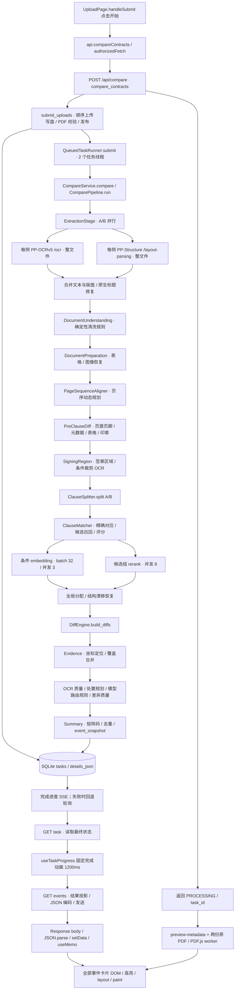

# 合同比对性能诊断报告

日期：2026-09-21。范围：当前工作树、本机隔离 API、真实远端 OCR/重排服务、生产构建的 React 前端。没有修改 `backend/app` 或 `frontend/src`，没有改变比对算法或模型参数。

本报告严格区分成功耗时、失败请求与未完成的压力请求。C/D/E 的完整链路测量使用显式 OpenCV 返回形状兼容适配；原始 OpenCV 5 环境的真实扫描件会失败，不能把兼容运行写成原环境已正常工作。尚未取得生产部署依赖与服务端 GPU tracing，因此以下结论是已测环境的证据，不是未经核实的生产耗时。

## 1. 当前调用链

入口已通过真实点击、网络请求与代码共同确认。上传成功后产品留在上传页，用户另行进入结果页；测试自动立即进入该任务，排除人工停留。

| 入口 / 核心函数 | 下游与同步操作 | 网络 / DB / 模型 / 循环 |
| --- | --- | --- |
| [frontend/src/pages/UploadPage.tsx:34](/Users/liyuanxin/PyCharmMiscProject/rixin-contract-comparison/frontend/src/pages/UploadPage.tsx:34) | handleSubmit → compareContracts → authorizedFetch | POST multipart；不等待整个 pipeline |
| [backend/app/api.py:66](/Users/liyuanxin/PyCharmMiscProject/rixin-contract-comparison/backend/app/api.py:66) | compare_contracts → CompareTaskApplication.submit_uploads | async 路由；上传读 await，写盘/校验/SQLite 同步 |
| [backend/app/application/compare_tasks.py:52](/Users/liyuanxin/PyCharmMiscProject/rixin-contract-comparison/backend/app/application/compare_tasks.py:52) | 两文件 stream_upload_to_path → validate_pdf_path → runner.submit | 顺序文件处理；队列后返回；无对象存储下载 |
| [backend/app/infrastructure/task_runner.py:218](/Users/liyuanxin/PyCharmMiscProject/rixin-contract-comparison/backend/app/infrastructure/task_runner.py:218) | 工作线程 _execute → _run_compare_job → CompareService | 本地队列，2 worker；重计算不直接在 async API 中运行 |
| [backend/app/services/compare_service.py:34](/Users/liyuanxin/PyCharmMiscProject/rixin-contract-comparison/backend/app/services/compare_service.py:34) | 构建 16 个阶段，ComparePipeline 顺序推进 | 阶段内有受限线程池；每阶段更新 SQLite/进度 |
| [backend/app/services/pipeline_stages.py:233](/Users/liyuanxin/PyCharmMiscProject/rixin-contract-comparison/backend/app/services/pipeline_stages.py:233) | ExtractionStage → hybrid → OCR/structure → merge | A/B 与两组件均并行；4 个整文件请求；后续区域 OCR 是另外的调用 |
| [backend/app/services/document_understanding.py:59](/Users/liyuanxin/PyCharmMiscProject/rixin-contract-comparison/backend/app/services/document_understanding.py:59) | understand_pair → understand → _apply_rule_page | 同步规则/正则；名称含 semantic，实际没有生成式 LLM |
| [backend/app/services/page_alignment.py:146](/Users/liyuanxin/PyCharmMiscProject/rixin-contract-comparison/backend/app/services/page_alignment.py:146) | _dynamic_alignment → _similarity → _anchor_similarity → _text_ratio | 本地 CPU；双层页循环和锚点循环；无模型/DB |
| [backend/app/services/matching/candidate_recall.py:23](/Users/liyuanxin/PyCharmMiscProject/rixin-contract-comparison/backend/app/services/matching/candidate_recall.py:23) | _build_candidates → exact/prefilter → _score_details → rerank | 小于 100 对或关闭 prefilter 才直接 exhaustive；正常路径仍有全体候选检索 |
| [backend/app/services/matching/providers.py:214](/Users/liyuanxin/PyCharmMiscProject/rixin-contract-comparison/backend/app/services/matching/providers.py:214) | batch embeddings；score_candidate_groups → score_candidates | embedding 32/批、并发 3；rerank 每原条款候选组一请求、并发 8；有有界重试 |
| [backend/app/services/diff/facade.py:8](/Users/liyuanxin/PyCharmMiscProject/rixin-contract-comparison/backend/app/services/diff/facade.py:8) | build_diffs → builder/range_refiner；证据及质量层继续局部比对 | CPU diff、正则和覆盖去重；不能把各处局部 diff 都当成重复整合同 diff |
| [backend/app/services/pipeline_stages.py:2854](/Users/liyuanxin/PyCharmMiscProject/rixin-contract-comparison/backend/app/services/pipeline_stages.py:2854) | Summary → matrix_graphics → build_snapshot → 持久化 | 本地 PDF 渲染/图像分析/JSON；报告导出不属于首次显示链路 |
| [backend/app/api_events.py:18](/Users/liyuanxin/PyCharmMiscProject/rixin-contract-comparison/backend/app/api_events.py:18) | get_events → 任务读取 → event_response → FastAPI JSON 编码 | 一次任务查询；按事件组装 children 和 projection，无逐 diff SQL |
| [frontend/src/pages/ResultPage.tsx:42](/Users/liyuanxin/PyCharmMiscProject/rixin-contract-comparison/frontend/src/pages/ResultPage.tsx:42) | getEvents → setData → filter/map → PdfDocumentViewer | 卡片全量 map；PDF canvas 已按可见页与邻页惰性渲染 |

文件类型边界：该入口只接受 PDF。DOCX 和独立图片由 `ensure_pdf_filename` 拒绝，未进入 Word/XML 解析或独立图片 pipeline。PDF 中的扫描图像属于 D；区域截图可被送至 OCR。把 DOCX 解析记作 0 秒会误导，应标注“不支持/未进入链路”。未发现 OpenTelemetry/APM 集成；复用 `PipelineMetrics`、`PerformanceRecorder`、remote timing 解析器，再增加隔离包装器。已有未提交 `task_observability.py` 未接入实际执行路径，不能把它存在于目录当成实际观测。

并发边界：比对任务进入 2-worker 队列，ExtractionStage 使用进程级 BoundedSemaphore（2），组件 OCR/版面并行，匹配模型使用有界线程池。pipeline 的页映射→条款候选→匹配→diff 有真实数据依赖；没有把相邻调用一概认定为可并行。上传 async 函数确有同步写盘/校验/SQLite；重计算位于后台线程仍不等于不受 GIL 影响。本轮未采事件循环 lag 或多任务排队压测，不能宣布 event loop 在生产并发下没有阻塞。

## 2. Benchmark 环境与数据集

macOS 26.0.1 / ARM64，14 核、36 GiB RAM；Python 3.13.5；FastAPI 0.138.2、PyMuPDF 1.28.0、RapidFuzz 3.14.5、NumPy 2.5.0、OpenCV 5.0.0。前端 Vite production build，真实 Chromium 页面；本机 API/浏览器间网络不代表远程用户 WAN。认证在独立 localhost 实例关闭，OIDC 刷新延迟不包含在这组数据中。

配置：双文件并行=true，OCR/版面组件并行=true，native fast path=off，native page mode=off，matching strategy=enabled，feature cache=true；embedding batch=32/inflight=3，rerank inflight=8；页级缓存 50,000 项，render cache 64 MiB。[environment.json](/Users/liyuanxin/PyCharmMiscProject/rixin-contract-comparison/output/analysis/e2e-20260921/environment.json) 保存配置、依赖、Git HEAD 和实际工作树文件 SHA256；不能仅用 commit 代表含未提交文件的代码。

| Case | 来源 | A/B 页数 | A/B 原生字符数 | 口径 |
| --- | --- | --- | --- | --- |
| A | synthetic_text | 8 / 8 | 14196 / 14196 | 8 pages each, 8 numbered clauses/page; one amount edit/page |
| B | synthetic_text | 40 / 40 | 72070 / 72070 | 40 pages each, 8 numbered clauses/page; one amount edit/page |
| C | real_text_composite | 119 / 120 | 70636 / 70678 | 119/120 pages: concatenate three real native-text contracts; revision adds one supplementary page. Separate pathological initial C retained. |
| D | real_text_scan | 40 / 40 | 26949 / 0 | real 40-page contract and 40-page scanned revision |
| E | real_different_structure | 40 / 25 | 26949 / 13246 | unrelated 40/25 page contracts |

A/B 为格式相同的英文合成压力合同；C 是三份真实中文原生文本 PDF 合并后附加一页补充条款，保留 119/120 页规模。D 为真实文本/扫描合同，扫描侧 40 页全部无文本层。E 为两份业务结构不同的真实合同。PDF 文件与 SHA256 固定后连续运行，不把这些合成样本当作业务准确率 Golden。完整清单见 [cases.json](/Users/liyuanxin/PyCharmMiscProject/rixin-contract-comparison/output/analysis/e2e-20260921/cases.json)。

每个 case 新启本地 API 进程，连续运行三次，标为 local first / warm 2 / warm 3。远端共享服务没有重启，不能声称测得完整模型 cold start。API 启动本身不计入“点击到结果”。只串行发起一个比对，无跨任务并发压测。P95 使用 nearest-rank；3 次时等于最大值，仅为本组描述统计，不是生产 P95 估计。

环境阻断：原始 D 在约 54 秒后失败，`ruled_table_recovery.py:55` 对 OpenCV 5 的 `(N,4)` 返回值按 `(N,1,4)` 解包。最小一条直线图像已独立复现。C/D/E 成功测量使用 `DIAG_OPENCV4_SHAPE=1`，只对该返回数组 reshape，坐标、顺序、dtype、底层数组均不变；生产代码未修改。见 [D-opencv5-failure/failure.json](/Users/liyuanxin/PyCharmMiscProject/rixin-contract-comparison/output/analysis/e2e-20260921/D-opencv5-failure/failure.json)。根目录另一虚拟环境的 OpenCV 为 4.13，本轮没有混入它的性能数据。

## 3. End-to-End Timing Breakdown

| Case | 首次 s | 第二次 s | 第三次 s | P50 s | P95 / max s |
| --- | --- | --- | --- | --- | --- |
| A | 17.218 | 16.124 | 16.173 | 16.173 | 17.218 |
| B | 98.990 | 99.982 | 100.012 | 99.982 | 100.012 |
| C | 215.037 | 232.398 | 225.286 | 225.286 | 232.398 |
| D | 75.638 | 75.672 | 75.725 | 75.672 | 75.725 |
| E | 75.089 | 74.969 | 75.106 | 75.089 | 75.106 |

起点：点击触发上传 fetch。终点：事件卡片全部进入 DOM、至少左右两个 PDF canvas ready、再经过两帧。首屏外 PDF 页按产品惰性渲染，不强制预渲染全合同。浏览器帧调度等待属于 ready 墙钟时间，不等于 React CPU。

样本输出边界：A 和 C 最终展示事件为 0，B/D/E 分别为 9/12/70。新增文字是否应形成差异不属于本轮性能正确性验收，不能用“流程完成”宣称比对准确率已验证。C 覆盖百页解析和匹配负载，但没有覆盖百页合同同时产生千条 diff 的前端负载。

| 阶段（均值 s） | A | B | C | D | E |
| --- | --- | --- | --- | --- | --- |
| 文档解析 / OCR / 版面 | 11.848 | 58.754 | 172.390 | 53.725 | 41.090 |
| 文本清洗规则 | 0.011 | 0.048 | 0.088 | 0.033 | 0.031 |
| 文档准备 / 表格恢复 | 0.159 | 0.558 | 5.229 | 0.672 | 0.625 |
| 页面序列对齐 | 0.438 | 15.261 | 17.685 | 3.930 | 2.660 |
| 页眉页脚 / 元数据 / 表格 diff | 0.390 | 1.548 | 5.765 | 2.679 | 1.154 |
| 签章区域 | 0.151 | 0.732 | 3.695 | 2.480 | 1.135 |
| 条款切分 | 0.143 | 0.886 | 1.201 | 0.412 | 0.260 |
| 条款匹配（含重排/embedding） | 0.411 | 12.187 | 12.705 | 6.109 | 15.200 |
| 条款 diff | 0.008 | 1.940 | 0.001 | 0.011 | 0.007 |
| 证据定位 | 0.005 | 0.121 | 0.015 | 0.015 | 1.960 |
| OCR 质量评估 | 0.002 | 0.003 | 0.007 | 0.003 | 0.003 |
| OCR 处置规划 | 0.001 | 0.001 | 0.001 | 0.027 | 0.002 |
| OCR 路由规则 | 0.001 | 0.001 | 0.003 | 0.002 | 0.002 |
| 差异质量处理 | 0.031 | 4.219 | 0.001 | 0.025 | 0.728 |
| 高亮信息准备 | 0.000 | 0.000 | 0.000 | 0.000 | 0.000 |
| 结果汇总 / 矩阵码 / 事件快照 | 0.153 | 0.806 | 2.664 | 2.572 | 2.960 |

B 第二次的可相加墙钟分解（总计 99.982 秒）：

| 阶段 | 秒 | 占端到端 |
| --- | --- | --- |
| 文档解析 / OCR / 版面 | 58.904 | 58.91% |
| 文本清洗规则 | 0.047 | 0.05% |
| 文档准备 / 表格恢复 | 0.515 | 0.52% |
| 页面序列对齐 | 15.273 | 15.28% |
| 页眉页脚 / 元数据 / 表格 diff | 1.491 | 1.49% |
| 签章区域 | 0.744 | 0.74% |
| 条款切分 | 0.891 | 0.89% |
| 条款匹配（含重排/embedding） | 12.297 | 12.30% |
| 条款 diff | 1.938 | 1.94% |
| 证据定位 | 0.122 | 0.12% |
| OCR 质量评估 | 0.004 | 0.00% |
| OCR 处置规划 | 0.001 | 0.00% |
| OCR 路由规则 | 0.001 | 0.00% |
| 差异质量处理 | 4.267 | 4.27% |
| 高亮信息准备 | 0.000 | 0.00% |
| 结果汇总 / 矩阵码 / 事件快照 | 0.956 | 0.96% |
| 点击至 pipeline 开始 | 0.016 | 0.02% |
| pipeline 阶段外工作 | 0.045 | 0.05% |
| pipeline 结束至浏览器 ready | 2.470 | 2.47% |

上表互斥阶段与余量相加为 TOTAL。DB、OCR 请求、embedding、rerank、序列化属于阶段内嵌套测量，在各专项表展开，不再重复加入总耗时。多线程请求累计时间可超过墙钟；同时给出请求区间并集。性能日志 `start/end` 与 Chrome Trace 都可还原 `*_start/end`。

`*-spans.jsonl` 与 timeline 统一附带 `comparison_id`、`root_request_id`；HTTP 请求本身保留独立 `request_id`。任务执行器外围的少量 SQL 没有原始任务上下文，按本轮“单任务串行”的起止窗归属，明确标为 `serial_run_time_window`；不能把这种补关联直接用于并发生产 tracing。`response_sent` 是 ASGI 最后 body 交付标记，不是客户端已收齐或 TCP ACK，客户端接收另测。

观测覆盖：request_received/file_prepare、document_parse、ocr、text_normalize（规则清洗阶段；细粒度归一化仍分布在解析和匹配内）、section_split、matching、diff、embedding/rerank 的实际 HTTP、DB execute、result_build、JSON 编码、response_sent、frontend_receive/parse/render-ready。生成式 LLM 没有执行路径，标为 N/A；纯网络传输、服务端 GPU 排队/推理、生产 OIDC 等未测量部分不填 0。

## 4. CPU Profile

对同一 B 输入单独执行完整真实 pipeline，在页对齐、规则清洗、切分、候选 `_score_details`、条款 diff、证据和差异质量这些同步 CPU 区间启用 cProfile。计时器为 `time.process_time`，关闭 builtins 单独追踪（其成本归到 Python 调用者），且每个区间断言只有一个 Python 线程；暂停 RSS/墙钟采样线程，避免跨线程归因重叠。以下 Top 函数只代表这些已采区间，不冒充全进程所有模块的 CPU 排名；OCR/HTTP/图像分析另有阶段墙钟和进程 CPU 数据。

已采 CPU 合计 50.254 秒、调用 12433411 次。完整附加运行进程 CPU 67.713 秒。结果通过 self time 非负及非递归累计时间不超过总采集时间的校验。原先多线程 cProfile 出现负值/累计归因重叠的尝试已排除，详见复现说明与 [profile-clock-check.json](/Users/liyuanxin/PyCharmMiscProject/rixin-contract-comparison/output/analysis/e2e-20260921/profile-clock-check.json)。追踪开销不纳入前面的基准百分位，不能把本表百分比直接当作未开 cProfile 的 CPU 占比。

Self time 前十：

| 函数 | 调用数 | self s | total s |
| --- | --- | --- | --- |
| difflib.py:305 find_longest_match | 1794948 | 30.192 | 30.833 |
| _fuzz.py:36 partial_score | 1331 | 9.143 | 9.143 |
| difflib.py:421 get_matching_blocks | 238196 | 1.739 | 33.045 |
| difflib.py:266 __chain_b | 238196 | 1.573 | 1.573 |
| difflib.py:597 ratio | 238101 | 0.733 | 29.754 |
| <string>:1 <lambda> | 1794948 | 0.641 | 0.641 |
| main.py:393 model_copy | 144934 | 0.525 | 1.227 |
| __init__.py:450 _make | 1293766 | 0.473 | 0.473 |
| difflib.py:619 <genexpr> | 1531636 | 0.410 | 0.410 |
| page_alignment.py:425 <genexpr> | 249600 | 0.325 | 11.009 |

Total time 前十（嵌套不可相加）：

| 函数 | 调用数 | self s | total s |
| --- | --- | --- | --- |
| difflib.py:421 get_matching_blocks | 238196 | 1.739 | 33.045 |
| difflib.py:305 find_longest_match | 1794948 | 30.192 | 30.833 |
| difflib.py:597 ratio | 238101 | 0.733 | 29.754 |
| pipeline_stages.py:803 execute | 1 | 0.000 | 26.703 |
| page_alignment.py:118 align | 1 | 0.004 | 26.700 |
| page_alignment.py:146 _dynamic_alignment | 1 | 0.012 | 26.660 |
| page_alignment.py:358 _similarity | 6320 | 0.119 | 26.563 |
| page_alignment.py:380 _group_supported | 3120 | 0.037 | 26.318 |
| page_alignment.py:431 _text_ratio | 236720 | 0.308 | 25.987 |
| candidate_scoring.py:19 _score_details | 1331 | 0.023 | 11.370 |

应用函数归因：

| 函数 | 调用数 | self s | total s |
| --- | --- | --- | --- |
| pipeline_stages.py:803 execute | 1 | 0.000 | 26.703 |
| page_alignment.py:118 align | 1 | 0.004 | 26.700 |
| page_alignment.py:146 _dynamic_alignment | 1 | 0.012 | 26.660 |
| page_alignment.py:358 _similarity | 6320 | 0.119 | 26.563 |
| page_alignment.py:380 _group_supported | 3120 | 0.037 | 26.318 |
| page_alignment.py:431 _text_ratio | 236720 | 0.308 | 25.987 |
| candidate_scoring.py:19 _score_details | 1331 | 0.023 | 11.370 |
| page_alignment.py:420 _anchor_similarity | 1600 | 0.103 | 11.121 |
| page_alignment.py:425 <genexpr> | 249600 | 0.325 | 11.009 |
| candidate_scoring.py:316 _body_score_details | 1331 | 0.004 | 9.200 |
| candidate_scoring.py:313 _partial_score | 1331 | 0.001 | 9.145 |
| _fuzz.py:36 partial_score | 1331 | 9.143 | 9.143 |

墙钟栈图中最宽的完整调用栈（另一轮仅做 50 ms 栈采样的运行，未启用 cProfile；排除诊断采样线程自身；全线程 occupancy 不等于单请求墙钟或 CPU 占比）：

| 栈尾路径 | 样本数 | 全线程 wall 样本占比 |
| --- | --- | --- |
| pipeline_stages.py:ExtractionStage._extract_side → ppstructure_ocr_hybrid.py:PPStructureOCRHybridExtractor.extract → ppstructure_ocr_hybrid.py:PPStructureOCRHybridExtractor._extract_components_parallel → _base.py:Future.result → threading.py:Condition.wait | 1894 | 22.5% |
| connection.py:HTTPConnection.handle_request → http11.py:HTTP11Connection.handle_request → http11.py:HTTP11Connection._receive_response_headers → http11.py:HTTP11Connection._receive_event → sync.py:SyncStream.read | 1890 | 22.4% |
| connection.py:HTTPConnection.handle_request → http11.py:HTTP11Connection.handle_request → http11.py:HTTP11Connection._receive_response_headers → http11.py:HTTP11Connection._receive_event → sync.py:SyncStream.read | 1267 | 15.0% |
| threading.py:Thread._bootstrap → threading.py:Thread._bootstrap_inner → threading.py:Thread.run → thread.py:_worker | 1259 | 14.9% |
| probe.py:install.<locals>.stage → pipeline_stages.py:ExtractionStage.execute → pipeline_stages.py:ExtractionStage._extract_pair → _base.py:Future.result → threading.py:Condition.wait | 1258 | 14.9% |

原生 C 压力采样：3 秒、10 ms 间隔，工作线程 272 次采样进入 RapidFuzz `fuzz_cpp`，268 次在同一最深 native 地址；这个短窗口不等于整个请求 CPU 占比。[C-live-native-sample.txt](/Users/liyuanxin/PyCharmMiscProject/rixin-contract-comparison/output/analysis/e2e-20260921/C-live-native-sample.txt)。CPU 详细表见 [profile-B/cpu-summary.json](/Users/liyuanxin/PyCharmMiscProject/rixin-contract-comparison/output/analysis/e2e-20260921/profile-B/cpu-summary.json) / [profile-B/cpu-top.txt](/Users/liyuanxin/PyCharmMiscProject/rixin-contract-comparison/output/analysis/e2e-20260921/profile-B/cpu-top.txt)。全线程墙钟栈图 [profile-B/wall-flamegraph.svg](/Users/liyuanxin/PyCharmMiscProject/rixin-contract-comparison/output/analysis/e2e-20260921/profile-B/wall-flamegraph.svg) 包含阻塞等待，明确不作为 CPU 百分比使用。

## 5. Network / LLM / Embedding 调用统计

各 case 第二次请求：

| Case | endpoint | 次数 | texts/documents | 平均 s | 累计 s | 区间并集 s | 服务报告 tokens | client 数 |
| --- | --- | --- | --- | --- | --- | --- | --- | --- |
| A | /layout-parsing | 2 | 0 | 8.565 | 17.130 | 11.350 | 未返回 | 1 |
| A | /ocr | 2 | 0 | 6.840 | 13.680 | 9.060 | 未返回 | 1 |
| A | /rerank | 14 | 338 | 0.114 | 1.592 | 0.228 | 32227 | 1 |
| B | /layout-parsing | 2 | 0 | 42.374 | 84.749 | 56.291 | 未返回 | 1 |
| B | /ocr | 2 | 0 | 34.819 | 69.637 | 46.103 | 未返回 | 1 |
| B | /rerank | 37 | 1041 | 0.264 | 9.766 | 1.419 | 236121 | 1 |
| C | /layout-parsing | 2 | 0 | 135.320 | 270.640 | 176.524 | 未返回 | 1 |
| C | /ocr | 2 | 0 | 99.967 | 199.934 | 132.887 | 未返回 | 1 |
| C | /rerank | 76 | 2280 | 0.161 | 12.273 | 1.666 | 263251 | 1 |
| C | /v1/embeddings | 39 | 1218 | 0.344 | 13.426 | 4.578 | 94994 | 1 |
| D | /layout-parsing | 2 | 0 | 40.061 | 80.123 | 52.856 | 未返回 | 1 |
| D | /ocr | 2 | 0 | 37.673 | 75.346 | 50.131 | 未返回 | 1 |
| D | /rerank | 97 | 2910 | 0.166 | 16.148 | 2.186 | 362152 | 1 |
| D | /v1/embeddings | 16 | 501 | 0.364 | 5.830 | 2.023 | 39885 | 1 |
| E | /layout-parsing | 2 | 0 | 34.031 | 68.062 | 40.519 | 未返回 | 1 |
| E | /ocr | 2 | 0 | 30.093 | 60.187 | 34.711 | 未返回 | 1 |
| E | /rerank | 251 | 7447 | 0.195 | 48.945 | 6.243 | 1101265 | 1 |
| E | /v1/embeddings | 12 | 377 | 0.375 | 4.495 | 1.605 | 27812 | 1 |

没有 `/chat/completions` 或其他生成式 LLM 调用，LLM request count=0，input/output tokens/TTFT=N/A。OCR 语义清洗、风险规划和 model routing 是本地规则，不能按命名推断模型请求。rerank 的 prompt/total tokens 取服务 `usage`；没有返回字段就记未提供，不按字符估算。

Embedding 实现已按 32 文本批处理、最多 3 并发，单 matcher 文本缓存复用；重复文本的 batch 去重开关当前关闭。是否触发以实际 endpoint 统计为准。rerank 是按原条款候选组请求，不是每条最终差异调用 LLM，最多 8 并发。每组输入截到 1600 字符、embedding 每条 1200 字符；本地相似度仍使用长文本。

重试：embedding 最多 3 次尝试、rerank 最多 2 次，无指数退避；OCR 主请求没有同类自动 retry 循环。追加裁剪 OCR 是另一业务检查，不应都统计成失败重试。HTTP 行逐尝试记录状态/耗时，matching metrics 的 failure counter 区分失败。HTTP/模型超时分别为 OCR 600 s、embedding 60 s、rerank 30 s。

匹配与模型实际调用规模（第二次）：

| Case | section A / B | A×B | 候选数 K | rule scoring s | embedding 请求/文本 | rerank 请求/文档 | LLM |
| --- | --- | --- | --- | --- | --- | --- | --- |
| A | 66 / 66 | 4356 | 390 | 0.124 | 0 / 0 | 14 / 338 | 0 |
| B | 114 / 113 | 12882 | 1331 | 10.655 | 0 / 0 | 37 / 1041 | 0 |
| C | 609 / 609 | 370881 | 37879 | 4.644 | 39 / 1218 | 76 / 2220 | 0 |
| D | 251 / 250 | 62750 | 8060 | 1.283 | 16 / 501 | 97 / 2850 | 0 |
| E | 251 / 126 | 31626 | 9796 | 1.059 | 12 / 377 | 251 / 7447 | 0 |

候选数不是所有底层字符串/向量 similarity 的总调用数。后者还含召回 top-k、邻居诊断和结构恢复；B 的精确函数次数见 cProfile，其他 case 未增加每个 native 函数的逐调用包装，不能用 K 冒充 similarity_call_count。E 第二次实际 embedding 12 个请求处理 377 个输入，376 个唯一未缓存文本；任务内复用 8,817 次，cosine pair cache miss 26,875 / hit 8,817。确认存在一条批内重复输入，但不存在本样本每个候选重复远端 embedding 的情况。

候选级 `_score_details` 次数可由代码和计数器核对：每个保留候选调用一次，精确候选被拒绝回退时额外调用一次，即 `candidate_count + exact_groups_fallback`。这不是估算全体相似度次数；更底层的每次 ratio、partial_ratio、cosine 是不同口径。

| Case | 候选级 score_details 次数（代码+counter） | 页 _text_ratio 实际 miss | 页 _text_ratio hit | 模型失败计数 |
| --- | --- | --- | --- | --- |
| A | 390 | 9456 | 0 | {} |
| B | 1331 | 236720 | 0 | {} |
| C | 37879 | 1262855 | 182760 | {'rerank_http_failure_count': 4} |
| D | 8060 | 257635 | 22046 | {'rerank_http_failure_count': 4} |
| E | 9796 | 194607 | 66597 | {} |

整文件 OCR 单独口径：

| Case | 侧 | PDF 页 | 服务返回页 | OCR HTTP s | HTTP / 页 s |
| --- | --- | --- | --- | --- | --- |
| A | original | 8 | 8 | 4.622 | 0.578 |
| A | compare | 8 | 8 | 9.060 | 1.132 |
| B | original | 40 | 40 | 46.104 | 1.153 |
| B | compare | 40 | 40 | 23.538 | 0.588 |
| C | compare | 120 | 120 | 132.877 | 1.107 |
| C | original | 119 | 119 | 67.067 | 0.564 |
| D | compare | 40 | 40 | 50.092 | 1.252 |
| D | original | 40 | 40 | 25.300 | 0.632 |
| E | compare | 25 | 25 | 34.700 | 1.388 |
| E | original | 40 | 40 | 25.470 | 0.637 |

每页值为整文件请求时长除以页数，包含网络和排队，不能当成 OCR engine 的逐页纯推理时间。整文件请求不在本机逐页 render；远端 DPI、页面内部并发和缓存未暴露。签章区域的裁剪 OCR 另计在 HTTP 总数中。

连接：OCR 与 structure 使用进程级单例 httpx client；matching providers 每次匹配创建一个 client，内部线程/组复用，匹配结束关闭。不存在每个候选对创建一个 client。附加 CPU 运行采集 httpcore transport events，可核对 TCP 建连和 response headers。远端没有返回 Server-Timing（remote_timing_available=0），HTTP 时长无法再拆成 GPU 排队、推理、网络；这些原因归入待验证假设。

附加 B 运行的 transport 实测（累计值，不加入正常 benchmark 排名）：

| endpoint | 请求 | TCP 建连 | TLS 握手 | TCP 合计 ms | 等待响应头 s | 收响应体 s |
| --- | --- | --- | --- | --- | --- | --- |
| /ocr | 2 | 2 | 0 | 3.378 | 69.386 | 0.099 |
| /layout-parsing | 2 | 2 | 0 | 1.454 | 103.939 | 0.114 |
| /rerank | 37 | 37 | 0 | 53.683 | 9.596 | 0.050 |

httpx client 复用不等于 TCP 连接已复用：重排请求实际多次建连，但上表建连毫秒数远小于等待响应头的时间。服务器/代理关闭连接还是池策略导致连接重建尚未确认，不能凭客户端单例推断 keep-alive 生效，也不能据此认定建连是主瓶颈。响应头等待包含服务端处理和网络往返，不代表已知纯推理耗时。附加墙钟栈还出现 `http_proxy.py:ForwardHTTPConnection.handle_request`，确认这次 HTTP 路径经过代理；代理的影响尚未单独测量，部署验收须固定实际路由，不能把这里的 HTTP 时长直接等同于直连 GPU 推理。

## 6. DB 调用统计

| run | SQL 数 | SELECT / INSERT | execute 合计 ms | 最大 ms | >50ms |
| --- | --- | --- | --- | --- | --- |
| A-r1 | 202 | {'SELECT': 138, 'INSERT': 64} | 6.901 | 0.332 | 0 |
| A-r2 | 202 | {'SELECT': 138, 'INSERT': 64} | 6.390 | 0.492 | 0 |
| A-r3 | 202 | {'SELECT': 138, 'INSERT': 64} | 6.041 | 0.425 | 0 |
| B-r1 | 202 | {'SELECT': 138, 'INSERT': 64} | 7.079 | 0.699 | 0 |
| B-r2 | 202 | {'SELECT': 138, 'INSERT': 64} | 6.482 | 0.784 | 0 |
| B-r3 | 202 | {'SELECT': 138, 'INSERT': 64} | 6.297 | 0.721 | 0 |
| C-r1 | 202 | {'SELECT': 138, 'INSERT': 64} | 5.926 | 0.649 | 0 |
| C-r2 | 202 | {'SELECT': 138, 'INSERT': 64} | 5.896 | 0.687 | 0 |
| C-r3 | 202 | {'SELECT': 138, 'INSERT': 64} | 5.678 | 0.616 | 0 |
| D-r1 | 202 | {'SELECT': 138, 'INSERT': 64} | 5.758 | 0.560 | 0 |
| D-r2 | 202 | {'SELECT': 138, 'INSERT': 64} | 5.545 | 0.539 | 0 |
| D-r3 | 202 | {'SELECT': 138, 'INSERT': 64} | 5.399 | 0.664 | 0 |
| E-r1 | 202 | {'SELECT': 138, 'INSERT': 64} | 49.129 | 35.542 | 0 |
| E-r2 | 202 | {'SELECT': 138, 'INSERT': 64} | 52.068 | 36.784 | 0 |
| E-r3 | 202 | {'SELECT': 138, 'INSERT': 64} | 51.811 | 38.303 | 0 |

SQLite 单连接 + RLock + WAL，busy_timeout=5000；同一任务按主键读取，进度 update 会读取/序列化/写回 `details_json`。查询量主要随阶段和进度事件增长，没有在最终事件/diff 循环内逐条查库。execute 指标不包含完整 Python 模型转换和全部 commit 开销，这些计入所属阶段/余量，不能用该毫秒数代替完整持久化耗时。

对任务读取和 revision 读取执行 `EXPLAIN QUERY PLAN`，均为 `SEARCH tasks USING INDEX sqlite_autoindex_tasks_1 (task_id=?)`。SQLite 不使用 PostgreSQL 风格 `EXPLAIN ANALYZE`；本轮没有超过 50 ms 的已测 execute 时，不虚构慢查询。原始计划：[db-query-plans.json](/Users/liyuanxin/PyCharmMiscProject/rixin-contract-comparison/output/analysis/e2e-20260921/db-query-plans.json)。列表页全表/索引扫描不属于当前任务结果链路。

## 7. 前端 Rendering Profile

| Case | 事件 | DOM | events MiB | events fetch s | JSON parse ms | 完成→发 events s | 事件→ready s | Script s | Layout s | long tasks | heap MiB |
| --- | --- | --- | --- | --- | --- | --- | --- | --- | --- | --- | --- |
| A | 0 | 141 | 0.003 | 0.011 | 0.400 | 1.205 | 1.354 | 0.208 | 0.009 | 0 | 36.535 |
| B | 9 | 358 | 0.437 | 0.047 | 6.900 | 1.204 | 1.186 | 0.199 | 0.031 | 0 | 35.433 |
| C | 0 | 364 | 0.039 | 0.018 | 1.600 | 1.204 | 1.765 | 0.492 | 0.061 | 3 | 37.135 |
| D | 12 | 427 | 0.172 | 0.035 | 2.500 | 1.203 | 1.914 | 0.241 | 0.022 | 2 | 36.387 |
| E | 70 | 2429 | 14.782 | 2.404 | 76.400 | 1.205 | 1.075 | 0.411 | 0.049 | 2 | 51.737 |

浏览器采集覆盖从上传到完整结果的主线程 CPU、long tasks、资源请求及 layout。`ScriptDuration` 包含这段流程所有脚本，不是 React 独占；生产 React 构建没有组件级 Profiler hook，不能虚报 React commit 次数。二次 rAF ready 包含帧调度以及可见 PDF 的剩余准备时间；DOM-ready/first-frame 标记在后续样本补齐，不能把整个 ready 区间都归因于 React。

本轮没有独立 paint duration 和组件级重复 render 次数；PDF.js worker CPU 也不在主线程 CPU profile 中。A/B 初始采集没有 visibility 字段，C/D/E 明确前台可见；因此不对 A/B 的帧等待做组件级归因。前端 CPU profile 可导入 DevTools，源码为 production bundle，未加 React development Profiler 以免改变基线。

确认存在固定 UI 等待：[frontend/src/lib/hooks.ts:10](/Users/liyuanxin/PyCharmMiscProject/rixin-contract-comparison/frontend/src/lib/hooks.ts:10) 的 `RESULT_COMPLETION_ANIMATION_MS=1200`，在 `onTerminal` 内 await 之后才 `setTask`，ResultPage 随后才 `getEvents`。这是可直接复现的时间延迟。PDF 在后台处理中已经开始加载，canvas 按 visible/neighbor window 挂载，不能建议“增加 PDF 虚拟化”而无视已有实现。事件列表是全量 map，但现有样本事件数不足以证明千条卡片场景；该规模待专门验证。

响应包括事件 projection、children、证据坐标、变更片段和匹配诊断；不存在 embedding 向量整批返回前端。E 第二次 events 响应实测 15,500,259 bytes（14.78 MiB），70 个展示事件；其体积与事件数并不成简单比例。结果组装 1.418 秒、model encode 0.561 秒、JSON 编码 0.130 秒；这些位于后端 GET events 内，不属于 React 渲染。JSON parse 约 76 ms，主线程全程 ScriptDuration 约 411 ms，不能据此把整个 75 秒等待归因于浏览器。

| Case | result build ms | model encode ms | JSON encode ms | events bytes | 正文消费 ms |
| --- | --- | --- | --- | --- | --- |
| A | 0.069 | 0.315 | 0.064 | 3257 | 2.500 |
| B | 13.195 | 9.502 | 2.618 | 457956 | 7.000 |
| C | 0.027 | 0.782 | 0.183 | 41367 | 9.600 |
| D | 5.565 | 4.636 | 0.995 | 180556 | 4.300 |
| E | 1417.983 | 561.315 | 130.386 | 15500259 | 83.000 |

从保存任务离线重建同一个 event_response，按字段统计 JSON value 大小（不含父字段名/分隔符，嵌套项不可重复求和）：

| Case | raw diff / events | JSON objects | diff 投影 + children 中最大字段 | 该字段 MiB |
| --- | --- | --- | --- | --- |
| A | 0 / 0 | 16 | - | 0.000 |
| B | 9 / 9 | 1424 | match_candidates | 0.142 |
| C | 0 / 0 | 127 | - | 0.000 |
| D | 12 / 12 | 622 | match_candidates | 0.066 |
| E | 344 / 70 | 137557 | original_evidence | 8.824 |

细分见 [payload-analysis.json](/Users/liyuanxin/PyCharmMiscProject/rixin-contract-comparison/output/analysis/e2e-20260921/payload-analysis.json)。读取坐标、审核与报告的消费者必须先核对，不能直接删除体积最大的字段。

## 8. Top Performance Bottlenecks

只按实际数据排序。每个 case 按三次均值取前五，包含 pipeline 阶段和完成后的 UI 等待、events 请求、浏览器 ready 区间；不把不同合同混成一个全局比例。浏览器 ready 墙钟不能等同于渲染 CPU，其内部未拆开的部分保留边界：

| Case | 排名 | 阶段 | 均值 s | 占 E2E |
| --- | --- | --- | --- | --- |
| A | 1 | 文档解析 / OCR / 版面 | 11.848 | 71.8% |
| A | 2 | 事件就绪→浏览器 ready（含帧调度） | 1.446 | 8.8% |
| A | 3 | 完成状态→events 请求（含固定动画） | 1.206 | 7.3% |
| A | 4 | 页面序列对齐 | 0.438 | 2.7% |
| A | 5 | 条款匹配（含重排/embedding） | 0.411 | 2.5% |
| B | 1 | 文档解析 / OCR / 版面 | 58.754 | 59.0% |
| B | 2 | 页面序列对齐 | 15.261 | 15.3% |
| B | 3 | 条款匹配（含重排/embedding） | 12.187 | 12.2% |
| B | 4 | 差异质量处理 | 4.219 | 4.2% |
| B | 5 | 条款 diff | 1.940 | 1.9% |
| C | 1 | 文档解析 / OCR / 版面 | 172.390 | 76.9% |
| C | 2 | 页面序列对齐 | 17.685 | 7.9% |
| C | 3 | 条款匹配（含重排/embedding） | 12.705 | 5.7% |
| C | 4 | 页眉页脚 / 元数据 / 表格 diff | 5.765 | 2.6% |
| C | 5 | 文档准备 / 表格恢复 | 5.229 | 2.3% |
| D | 1 | 文档解析 / OCR / 版面 | 53.725 | 71.0% |
| D | 2 | 条款匹配（含重排/embedding） | 6.109 | 8.1% |
| D | 3 | 页面序列对齐 | 3.930 | 5.2% |
| D | 4 | 页眉页脚 / 元数据 / 表格 diff | 2.679 | 3.5% |
| D | 5 | 结果汇总 / 矩阵码 / 事件快照 | 2.572 | 3.4% |
| E | 1 | 文档解析 / OCR / 版面 | 41.090 | 54.7% |
| E | 2 | 条款匹配（含重排/embedding） | 15.200 | 20.3% |
| E | 3 | 结果汇总 / 矩阵码 / 事件快照 | 2.960 | 3.9% |
| E | 4 | 页面序列对齐 | 2.660 | 3.5% |
| E | 5 | events 请求/组装/编码/收包 | 2.490 | 3.3% |

未完成 C-pathological 不进入排名或百分位：已观测点击后至少 1733.891 秒仍无完整结果；条款匹配至少 1393.092 秒，其中首次 rerank 请求前已过去 1389.312 秒。用这个下界能排除“这些等待全部来自 rerank HTTP”的解释，但不能补造该任务最终完成耗时。

## 9. Root Cause Analysis

**RC1：全文件 OCR/版面提取构成固定的远端关键路径。** native fast path 与 native page mode 均 off，文本 PDF 也提交到两个远端服务；A/B 两侧各一次整文件请求，后续区域检查按实际情况追加。B 页面均有文本层，但仍执行两路识别。共享 base64 编码已复用，并行也已开启，不能把问题归结为“未并行”或“重复文件编码”。真正可确认的是输入工作量与远端请求关键路径；服务内排队/GPU 推理的细分目前没有证据。相关位置：[backend/app/services/pipeline_stages.py:394](/Users/liyuanxin/PyCharmMiscProject/rixin-contract-comparison/backend/app/services/pipeline_stages.py:394)、[backend/app/services/extractors/ppstructure_ocr_hybrid.py:85](/Users/liyuanxin/PyCharmMiscProject/rixin-contract-comparison/backend/app/services/extractors/ppstructure_ocr_hybrid.py:85)。改动风险：直接跳过 OCR 会改变文本源、表格和坐标证据，不能无回归直接启用。

**RC2：页面动态规划对所有页对与锚点组合计算相似度。** `costs`、`moves` 都是 `(P+1)×(Q+1)`；每个可达状态评估单页/拆并页转换。`_anchor_similarity` 对最多 12×12 个锚点调用 `SequenceMatcher.ratio`，同时比较整页文本。B 的 40×40 页对形成 236,720 次 `_text_ratio` cache miss；初始压力 C 120×120 的页面对齐达到 151.742 秒，相比 B 约 15 秒呈超线性增长。复杂度下界是页对 O(PQ)，乘上文本相似度和锚点成本；不能只写 O(n²) 而省略文本长度。现有 LRU 上限 50,000，B 的该缓存命中为 0，增加容量不自动消除不同文本间的必要计算。相关：[backend/app/services/page_alignment.py:146](/Users/liyuanxin/PyCharmMiscProject/rixin-contract-comparison/backend/app/services/page_alignment.py:146)、[backend/app/services/page_alignment.py:358](/Users/liyuanxin/PyCharmMiscProject/rixin-contract-comparison/backend/app/services/page_alignment.py:358)、[backend/app/services/page_alignment.py:420](/Users/liyuanxin/PyCharmMiscProject/rixin-contract-comparison/backend/app/services/page_alignment.py:420)。算法剪枝会影响跨页拆并和定位，风险高。

**RC3：候选评分的单对成本随条款长度急升；条款数少不代表轻量。** `_score_details` 对候选计算 ratio/token_set/partial_ratio，再用 ClauseAlignmentAnalyzer 的 SequenceMatcher 做诊断。B 的候选总数 1,331，远少于 114×113=12,882，但本地 rule_candidate_scoring 仍约 10 秒。C-pathological 133/131 个实际条款中最大 74,209 字符，评分发生在 model 输入截断之前；首次 rerank 之前已耗时逾 1,389 秒，原生采样集中在 RapidFuzz。根因链为“切分产生超长条款 → 对长文本运行昂贵 partial similarity → 候选数×单对成本放大”，不是 100 条差异串行调用 100 次 LLM。[backend/app/services/matching/candidate_scoring.py:316](/Users/liyuanxin/PyCharmMiscProject/rixin-contract-comparison/backend/app/services/matching/candidate_scoring.py:316)、[backend/app/services/matching/_fuzz.py:35](/Users/liyuanxin/PyCharmMiscProject/rixin-contract-comparison/backend/app/services/matching/_fuzz.py:35)、[backend/app/services/clause_alignment.py:85](/Users/liyuanxin/PyCharmMiscProject/rixin-contract-comparison/backend/app/services/clause_alignment.py:85)。这个极端案例是合成英文压力输入，不外推为所有中文合同的平均性能。

B 的附加 CPU 采集中，`partial_score` 实际 1331 次、self CPU 9.143 秒；最长条款 9,049 字符。它把正常 B 的本地评分耗时进一步定位到具体函数。C-pathological 的 74,209 字符案例还需单对隔离实验，当前短原生采样不提供每一对的 CPU 分解。

**RC4：任务完成后的固定动画延迟推迟结果请求。** 完成状态已到达浏览器后仍 await 1200 ms，随后请求 events。它不属于网络慢、数据库慢或 React diff 计算慢。调整展示时机属于 UI 行为变更，风险低；理论可移除的固定等待上限为 1.2 秒，实际端到端收益需对照测量。

**RC5：事件投影和 children 重复携带证据坐标，增加结果组装与传输成本。** E 的 7564 个证据框只有 3782 个唯一序列化内容；完全相同证据的额外副本共 6454865 bytes，占完整响应 41.6%。包括重复副本的字符框 58560 个，char_boxes value 合计 10652006 bytes。[backend/app/services/diff_events/__init__.py:295](/Users/liyuanxin/PyCharmMiscProject/rixin-contract-comparison/backend/app/services/diff_events/__init__.py:295) 先 deep copy 投影，再在第 352–353 行同时输出 diff 与 children。实际 GET events 2.284 秒，包含 result build 1.418 秒、model encode 0.561 秒和 JSON encode 0.130 秒。这个根因对 E 的后处理成立，不超过已测 OCR/匹配成本；去重后能减少多少字节可由当前重复量界定，但速度收益不能按字节占比推算。

条款匹配复杂度补充：prefilter 并非纯 O(n)。每个未走精确对应的原条款仍遍历 compare 进行位置/页面筛选和 RapidFuzz top-k，因此召回存在 O(nm) 扫描；详细评分是候选数 K×字符串成本，分配还需排序。没有把 embedding 放进所有 n×m 对内请求；embedding 成功后有任务内缓存。默认 greedy 分配不建立 N×M embedding 浮点矩阵；page alignment 确实建立二维表。

缓存与文件生命周期：共享编码每文件一次；native 标题/证据修复、表格恢复、图像签章/矩阵码等会再次打开 PDF。opens/文本提取/栅格化实际次数见下表，不能把所有 open 当成同一目的的重复 parse。matcher 缓存、render cache、页相似度缓存均为任务内缓存；重复比对会再次 OCR/解析/重排，本组 warm 请求的网络计数验证了这一点。没有新增跨任务缓存。

B 第二次的文件生命周期计数：

| 阶段 | PDF open | get_text | get_pixmap |
| --- | --- | --- | --- |
| outside_pipeline | 4 | 0 | 0 |
| 文档解析 / OCR / 版面 | 10 | 240 | 0 |
| 文档准备 / 表格恢复 | 12 | 80 | 0 |
| 页眉页脚 / 元数据 / 表格 diff | 80 | 0 | 80 |
| 签章区域 | 3 | 0 | 80 |
| 证据定位 | 2 | 0 | 0 |
| 结果汇总 / 矩阵码 / 事件快照 | 2 | 0 | 80 |

打开文件不等于完整重跑 OCR；这里分别计数。本机 ruled table 使用 2× 灰度渲染，签章/矩阵码各有尺度、颜色与裁剪范围，不能未经等价验证复用同一 pixmap。服务端整文件 OCR 的内部 render 次数和 DPI 未暴露。

规模与耗时（第二次；实际切分结果，不把页数直接当条款数）：

| Case | 页 A/B | 原生字符 A/B | 解析 block A/B | 条款 A/B | 最长条款 A/B | 页面对齐 s | 匹配 s |
| --- | --- | --- | --- | --- | --- | --- | --- |
| A | 8/8 | 14196/14196 | 272/272 | 66/66 | 正常任务按应用保留策略已清理/正常任务按应用保留策略已清理 | 0.440 | 0.409 |
| B | 40/40 | 72070/72070 | 1360/1360 | 114/113 | 9049/9049 | 15.273 | 12.297 |
| C | 119/120 | 70636/70678 | 2578/2578 | 609/609 | 2344/2344 | 17.670 | 12.952 |
| D | 40/40 | 26949/0 | 1017/1061 | 251/250 | 2344/2341 | 3.918 | 6.079 |
| E | 40/25 | 26949/13246 | 1017/605 | 251/126 | 2344/530 | 2.553 | 15.270 |

B 的长度来自相同输入的附加有效 CPU 运行；A 的长度中间文件已被应用清理，未补造。A→B 保持合成格式并把页数放大 5 倍；页面对齐由约 0.44 s 增至 15.27 s，匹配由约 0.40 s 增至 12.29 s。C 为不同内容的真实组合，不能与 A/B 拟合一个精确幂律；C-pathological 与 A/B 同族但未完成，只有阶段下界。解析 block 与条款是本项目真实数据结构，没有另造一个“段落数”。扫描 D 的原生字符为 0 不代表 OCR 后没有文本。

| run | PDF open | get_text | get_pixmap | CPU s | 峰值 RSS MiB | 结束 RSS MiB | GC 代际次数 |
| --- | --- | --- | --- | --- | --- | --- | --- |
| A-r1 | 49 | 64 | 48 | 4.397 | 388.609 | 398.719 | [358, 32, 3] |
| A-r2 | 49 | 64 | 48 | 4.239 | 398.031 | 404.406 | [346, 32, 3] |
| A-r3 | 49 | 64 | 48 | 4.276 | 403.672 | 404.562 | [346, 31, 3] |
| B-r1 | 113 | 320 | 240 | 50.769 | 594.375 | 555.266 | [1719, 156, 11] |
| B-r2 | 113 | 320 | 240 | 50.959 | 605.766 | 563.688 | [1708, 155, 12] |
| B-r3 | 113 | 320 | 240 | 50.887 | 580.438 | 554.953 | [1709, 156, 10] |
| C-r1 | 389 | 1199 | 1002 | 84.908 | 879.625 | 874.562 | [2374, 216, 12] |
| C-r2 | 389 | 1199 | 1002 | 83.872 | 1017.234 | 783.641 | [2372, 216, 11] |
| C-r3 | 389 | 1199 | 1002 | 83.956 | 970.859 | 932.688 | [2370, 216, 11] |
| D-r1 | 216 | 573 | 304 | 28.812 | 1041.531 | 873.375 | [607, 56, 5] |
| D-r2 | 216 | 573 | 304 | 28.251 | 1041.828 | 876.094 | [604, 55, 5] |
| D-r3 | 216 | 573 | 304 | 28.434 | 946.750 | 681.312 | [607, 55, 4] |
| E-r1 | 145 | 474 | 241 | 27.998 | 646.375 | 599.250 | [1262, 115, 9] |
| E-r2 | 145 | 474 | 241 | 27.902 | 754.734 | 699.203 | [1261, 115, 9] |
| E-r3 | 145 | 474 | 241 | 27.796 | 757.422 | 688.875 | [1259, 115, 9] |

RSS 为 100 ms 采样峰值，CPU 为该次 compare 进程 CPU delta；CPU 可因线程累加而超过墙钟。warm RSS 上升只能证明分配器/缓存保留，三次数据不足以证明泄漏或 GC 根因。没有测得 Python 临时对象的精确峰值数量。正则很多，但没有 CPU 证据证明 catastrophic backtracking，不列为瓶颈。

## 10. P0 优化建议

1. 先处理运行阻断：明确并固定 OpenCV 主版本，或单独修正 `segments` 形状兼容；增加两种返回形状的数值等价回归。目标是恢复真实合同可执行性，不报性能提升百分比。
2. 让最终 events 请求与完成动画并行，或数据 ready 时立即显示结果，进度动画单独结束。已知固定等待是 1200 ms；收益上限与实际收益分开验收。
3. 保留按需启用的阶段/请求计数，补上 OCR 服务端 request_id、queue/inference/serialize 的 Server-Timing。此项主要消除归因盲区，没有直接加速收益数字。

## 11. P1 优化建议

1. 针对最长条款建立独立 benchmark 与语义等价试验，再决定是否复用分数或分解诊断计算。不要截断本地条款来换速度，也不要直接用 RapidFuzz 替代方向敏感的 SequenceMatcher。
2. 评估按内容 SHA256 + 提取器/模型版本 + 全部识别配置的持久化 OCR/解析缓存。重复请求已有显著远端工作量，但失效、权限、坐标和模型升级均需验证；预计下降，需要 benchmark 验证。
3. 根据服务端实测排队和吞吐调整两文件/两组件并发额度。当前已并行，禁止无上限增加并发。模型 client 跨任务复用须衡量建连实际占比，不列为未经证实的主收益项。

4. 为 event_response 设计版本化的共享证据引用，或者按前端实际需要取 children 细节。E 已证明完全重复证据约 6.45 MB；保持原有事件 ID、审核操作、定位坐标和导出语义，兼容期保留旧接口。响应大小收益有实测依据，CPU/网络/渲染收益仍需 benchmark。

## 12. P2 架构优化建议

1. 页序对齐先建立可验证的强锚点或候选窗口，仅对有证据的页对做昂贵拆并搜索，并保留完整回退路径。必须证明所有页面映射、跨页差异、证据坐标不退化。
2. 分离长条款召回、轻量打分和精确评分，约束昂贵字符串相似度的调用域；比较原评分与新评分的每个候选、排序、最终配对，不能仅比较最终 diff 数量。
3. 原生文本/混合页的提取路由需以业务 Golden 和坐标证据等价为前提；文本型 PDF 全文 OCR 的工作量真实存在，但“有文本层”并不自动说明可以跳过 OCR。
4. 生产并发增加时才评估独立任务进程/队列和 CPU worker 配置，本组单任务数据不足以证明多实例收益。

## 13. 预计收益与风险

| 方案 | 收益证据 / 预期 | 复杂度 | 业务语义风险 | 验证 |
| --- | --- | --- | --- | --- |
| OpenCV 返回形状兼容 | 解除已复现的失败；不属于速度提升 | 低 | 不改变坐标/顺序；需版本验证 | N4/N14 两形状 + 真实表格 Golden |
| 结果请求与动画解耦 | 已测固定 1.2 s 等待；实际收益需 A/B | 低 | 结果显示时机改变 | 同一任务记录 completed→events→ready |
| OCR/解析跨任务缓存 | 避免重复远端工作；需 benchmark 验证 | 中 | 版本/配置/权限/坐标一致性 | 冷/热命中与失效、输出哈希与 Golden |
| 长条款评分复用/分层 | CPU 与压力案例证明计算负担；收益待验证 | 中高 | 配对/评分变化会影响准确率 | 候选/分数/映射逐项比较 |
| 共享证据引用 / 按需详情 | E 完全重复证据约 6.45 MB；时间收益待验证 | 中 | 接口结构/定位/审核兼容 | 逐字段坐标、事件、审核与导出回归 |
| 页对候选剪枝 | O(PQ) 和实测增长证明计算规模；收益待验证 | 高 | 拆并页与定位风险高 | 重排/增删/合并页专项 + 全量回退 |
| 前端虚拟事件列表 | 当前仅全量 DOM 事实；千条规模收益未测 | 中 | 滚动定位/审核状态 | 500/1000/2000 事件独立渲染测试 |

本轮不承诺“提升 80%”之类未经对照实验的数字，不删除模型分析、异常处理或业务 diff。诊断适配器留在 experiments 下供审查，不能隐式进入生产。

## 14. 建议修改的具体文件 / 函数

| 文件 / 函数 | 后续范围 |
| --- | --- |
| [backend/app/services/ruled_table_recovery.py:55](/Users/liyuanxin/PyCharmMiscProject/rixin-contract-comparison/backend/app/services/ruled_table_recovery.py:55) | recover_ruled_tables.analyze：返回 shape 兼容；独立缺陷修复 |
| [frontend/src/lib/hooks.ts:257](/Users/liyuanxin/PyCharmMiscProject/rixin-contract-comparison/frontend/src/lib/hooks.ts:257) | onTerminal：数据请求与固定动画解耦 |
| [backend/app/services/page_alignment.py:146](/Users/liyuanxin/PyCharmMiscProject/rixin-contract-comparison/backend/app/services/page_alignment.py:146) | _dynamic_alignment / _similarity / _anchor_similarity：算法实验 |
| [backend/app/services/matching/candidate_scoring.py:316](/Users/liyuanxin/PyCharmMiscProject/rixin-contract-comparison/backend/app/services/matching/candidate_scoring.py:316) | _body_score_details：长文本单对耗时与等价复用 |
| [backend/app/services/clause_splitter.py:99](/Users/liyuanxin/PyCharmMiscProject/rixin-contract-comparison/backend/app/services/clause_splitter.py:99) | split：长条款分布诊断；不能直接改切分语义 |
| [backend/app/services/extractors/ppstructure_ocr_hybrid.py:85](/Users/liyuanxin/PyCharmMiscProject/rixin-contract-comparison/backend/app/services/extractors/ppstructure_ocr_hybrid.py:85) | extract：提取结果复用/路由实验 |
| [backend/app/services/matching/providers.py:214](/Users/liyuanxin/PyCharmMiscProject/rixin-contract-comparison/backend/app/services/matching/providers.py:214) | 请求去重/连接跨任务复用仅按实测决定 |
| [backend/app/services/remote_metrics.py:12](/Users/liyuanxin/PyCharmMiscProject/rixin-contract-comparison/backend/app/services/remote_metrics.py:12) | 与远端服务协同补 queue/inference/timing |
| [frontend/src/pages/ResultPage.tsx:125](/Users/liyuanxin/PyCharmMiscProject/rixin-contract-comparison/frontend/src/pages/ResultPage.tsx:125) | 大事件量专项证实后才评估列表虚拟化 |

响应瘦身涉及 [backend/app/services/diff_events/__init__.py:284](/Users/liyuanxin/PyCharmMiscProject/rixin-contract-comparison/backend/app/services/diff_events/__init__.py:284) 的 `event_response` 及前端事件类型、EventCard/PdfDocumentViewer 消费者，必须作为有版本的 API 改动单独审查。

## 15. 优化后的 Benchmark 验收方案

1. 固定本次输入 SHA256、代码/依赖/配置和硬件；分别维护原环境失败基线、兼容环境成功基线。先在目标部署依赖环境复测，禁止把适配实验直接等同于生产。
2. 每个候选只改变一个变量，按 baseline/candidate 交替运行，同样的 cold/warm 语义。A–E 至少各三次用于回归，面向 P95 结论增加到足够样本并给置信区间；保留失败和超时，不能只统计成功的快请求。
3. 比较端到端、阶段互斥时间、CPU/RSS/GC、SQL、OCR/embedding/rerank 次数、token、候选数量和最长条款，不只比较单次 API latency。远端 timings 仍缺失时保留 unknown。
4. 必须保持 diff、事件、审核状态、原文/新版页映射、char boxes 和所有证据坐标；涉及 pipeline 的修改执行项目 Golden 15-contract 阻断门禁，不能修改 Golden 使结果通过。
5. 单独保留 C-pathological：先测最长条款与单对 partial similarity，给明确超时预算/取消行为，再重复整链路三次。它不应被“普通大合同通过”替代。
6. 前端完成时间需从真实点击开始；记录 DOM-ready、可见 canvas-ready、paint/帧调度、浏览器 visibility，并排除人工停留。增加 500/1000/2000 事件压力样本之后，才决定虚拟化。
7. 在生产同等认证、反向代理、带宽与并发下另跑队列/池等待验证，区分本地 CPU、共享 GPU 排队和网络。

**待验证假设（未作为最终根因排序）**：远端 GPU 队列与推理各占多少；生产是否使用 OpenCV 5；真实百页中文合同出现 7 万字符条款的频率；真实千事件 React 渲染上限；长时间循环后的内存保留是否为泄漏；OIDC/网关/WAN 延迟；并发 2+ 任务时 GIL、SQLite 锁和远端限流对 P95 的贡献。

复现与证据：[experiments/e2e_diagnosis/README.md](/Users/liyuanxin/PyCharmMiscProject/rixin-contract-comparison/experiments/e2e_diagnosis/README.md)；汇总 [analysis.json](/Users/liyuanxin/PyCharmMiscProject/rixin-contract-comparison/output/analysis/e2e-20260921/analysis.json)；每轮 `*-browser-cpu.json` 是可导入 DevTools 的 CPU profile，`*-timeline.json` 是 Chrome Trace，`A/…E/spans.jsonl` 是原始数值跨度。应用文件 SHA256 已核对未变化。前端 production build 成功，诊断脚本 compileall 通过；本轮没有生产代码修改，因此不以“Golden 已通过”作未经运行的声明。
