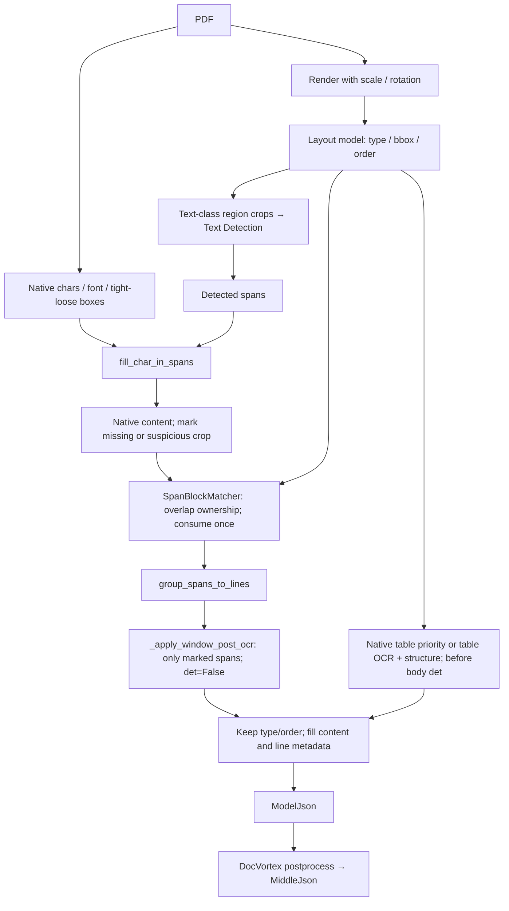
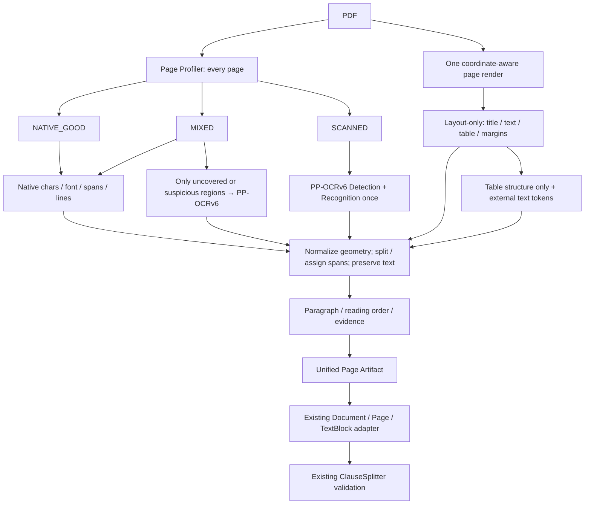

# Extraction Architecture Analysis

日期：2026-09-21。项目 HEAD：`48a23804c1273ef59deea775707047efc60ae339`，分析对象包含本轮开始时已存在的工作区改动。

**结论：当前架构同时消费两套整页范围的文字识别结果；Native Fast Path 的已知失败主要是语义与结构契约缺失，并非该样本的 native 正文错误。MinerU 提供了把文字来源、版面语义和按需 Recognition 分离的源码实例，值得移植的是这种组合方式。**

**证据边界：还不能宣称“远端实际每个模型 forward 次数已经证明”。** 本轮已追完项目调用链、既有真实响应、PaddleX 上游识别与表格分支，以及 MinerU/DocVortex 源码；但没有取得远端部署代码、有效配置、权重 identity 和内部 span trace。API 的 `FastAPI 0.1.0` 不是模型版本。下文明确区分已观测、上游源码条件结论和未核实项，绝不以 HTTP 请求数替代 Recognition 次数。

本轮停止了发现仍在运行的旧 `run_golden_candidate.py scoring` 进程，保留已落盘产物；没有撤销已有修改，没有继续 Page Alignment / Candidate Scoring / Event payload / Cache / 动画 / Golden / pathological matching 或其他性能项。没有修改生产 ExtractionStage，没有安装 MinerU，也没有运行新的 compare 或 A–E benchmark。

证据附件：[Native 字段与切分原因][native-report]、[模型 identity 影响][identity-report]、[MinerU 逐版本源码调用链][mineru-report]、[本轮只读证据目录][evidence]。

## 1. Current Extraction Call Graph

### 项目侧已核实的调用

`ExtractionStage.execute → _extract_pair → _extract_side → PPStructureOCRHybridExtractor.extract`，original/compare 两侧各构建并执行一套 hybrid。hybrid 串行或并行调用两个 component，二者均接收整份 PDF 的 base64；共享编码只减少本地编码，不共享远端识别结果。[ExtractionStage][c-stage] [hybrid component][c-hybrid] [request bodies][c-ocr-body] [Structure request][c-layout-body]

```text
compare(original.pdf, compare.pdf)
  └─ 每侧 ExtractionStage
      └─ PPStructureOCRHybridExtractor
          ├─ PPOCRV5Extractor → 8088 /ocr                整份 PDF
          │   └─ 文字、置信度、行框、词/字符位置
          └─ PPStructureExtractor → 8089 /layout-parsing 整份 PDF
              └─ layout + overall_ocr_res + table / seal / formula 等
          ↓
          _merge_documents
          ├─ 文字对象按空间关系附加 type / layout bbox / order / role
          ├─ 表格 / structure-only regions / 局部第二读法
          └─ assign_page_reading_order → Document / Page / TextBlock
```

默认 `compare_document_extractor=ppstructure_ocr_hybrid`、native 两个开关均为 off。上述计数针对本题已经确认的“两个端点各整文件一次”的成功路径；native enabled、page routing、局部补识别、重试属于不同路径，不合并成固定四次。[factory][c-factory] [config][c-config]

### 远端到模型：已追透的上游实现与部署缺口

本地保留的服务说明将服务标为 **paddlex --serve，PP-OCRv6 / PP-StructureV3**。本轮 GET `/health`、`/openapi.json` 两服务均 200，端点分别只有 `/ocr` 和 `/layout-parsing`。OpenAPI 不含运行模型或构建身份；两服务请求 schema 都没有关闭正文 Recognition 的开关。

以下源码图固定到 PaddleX release/3.7 commit `ffb64904d23708863ff5b8da312a5cbd52a7f462`。它是可核查的上游参考实现，**不是已验证的远端部署 commit**；本地另一实验安装的 PaddleX 是 3.2.0，也不能冒充远端版本。源码快照、SHA256、远端 schema 均保存在证据目录。

```text
PDF（是否有 native text 不改变这一上游服务路径）
  ↓ POST /ocr
basic_serving/_pipeline_apps/ocr.py:create_pipeline_app._infer
  ↓ _common/ocr.py:get_images
  ↓ serving/infra/utils.py:file_to_images → read_pdf
  ↓ PDF render → page images                  ← 在模型推理之前
OCRPipeline → _OCRPipeline.predict
  ↓ TextDetection 模型：text_det_model(images)
  ↓ dt_polys → crop text lines → sort by aspect ratio
  ↓ TextRecognition 模型：text_rec_model(line crops)
  ↓ score filter / word geometry → rec_texts, rec_scores, rec_boxes

PDF
  ↓ POST /layout-parsing
basic_serving/_pipeline_apps/pp_structurev3.py:create_pipeline_app._infer
  ↓ get_images → file_to_images → read_pdf → PDF render
LayoutParsingPipelineV2 / _LayoutParsingPipelineV2（pipeline_name=PP-StructureV3）
  ↓ LayoutDetection + 可选 RegionDetection
  ↓ 可选 FormulaRecognition，公式区域可能被遮白
  ↓ GeneralOCR = OCRPipeline
      TextDetection → line crops → TextRecognition → overall_ocr_res
  ├─ TableRecognition：复用 overall_ocr_res；条件性局部再识别
  ├─ SealRecognition：独立印章文字 Detection / Recognition
  ├─ ChartRecognition / FormulaRecognition：独立任务
  ↓ standardized_data：跨 layout 框 / 无文字区域可能再 Recognition
  ↓ LayoutBlock.update_text_content：公式混排行分割可能再 Recognition
  ↓ XY-cut layout order → parsing_res_list / tables / markdown
```

[OCR HTTP handler][p-ocr-service] [PDF render][p-render] [OCR pipeline][p-ocr] [Structure HTTP handler][p-layout-service] [Structure pipeline][p-layout] [Layout text formatting][p-layout-objects]

名称容易误导：项目的 `models/layout_detector.py:69` 同样调用完整 `/layout-parsing`；这个类名也不代表远端是 layout-only。`LayoutParsingPipelineV2` 是 PaddleX 实现类名，服务 pipeline 的产品名为 PP-StructureV3，不能把类名 V2 误解为产品 V2。[项目 LayoutDetector][c-detector]

### 两端点逐项回答

| 问题 | `/ocr` | `/layout-parsing` |
|---|---|---|
| Text Detection | 上游 `_OCRPipeline.predict` 必走；既有响应有 `dt_polys` | GeneralOCR 必走；与 Layout Detection 是不同模型任务 |
| Text Recognition | 非空检测行进入 `text_rec_model`；响应有识别文字和分数 | GeneralOCR 执行 Recognition；还存在后处理/表格/印章局部识别 |
| 真实 family/version | 用户及服务说明确认 PP-OCRv6；精确 det/rec 型号与权重待远端核实 | 服务说明为 PP-StructureV3；其 GeneralOCR、table OCR、seal OCR 的各自实际版本待核实 |
| 每页 Recognition 几次 | 上游为一轮检测行集合识别；每个有效 crop 一次常规识别，内部按 batch forward | 一轮 GeneralOCR 检测行集合识别，再加条件性 region/span/table/seal 识别 |
| `overall_ocr_res` | 直接页级识别结果，无此包装要求 | **已观测存在** |
| `rec_texts / rec_scores / rec_boxes` | **已观测存在** | **已观测在 overall_ocr_res 中存在** |
| 是 PP-Structure / V3 / 自定义 | 不适用，OCR pipeline | 服务说明、schema、响应符合 PP-StructureV3；是否有部署 patch 仍未知，不能仅凭 `/layout-parsing` 名证明 |
| table 内会再识别吗 | 不做 Table Structure Recognition；表内文字包含在普通检测行中 | **上游有条件性再识别，详见第 4 节；本次没有实际分支计数** |

## 2. Actual OCR Model Identity

**本轮采用真实身份 PP-OCRv6，不把 `PPOCRV5Extractor` 当作真实模型。** 同时不将所有历史 artifacts 倒填为 v6，也不推断 Structure 内嵌 GeneralOCR 一定与独立 `/ocr` 使用同一权重。

| Identity 层 | 当前事实 | 不能混同的内容 |
|---|---|---|
| 历史 Python adapter | `PPOCRV5Extractor`, `ppocrv5`, `PPOCRV5_*` | 不加载模型，不选择 v5/v6；URL 决定服务 |
| 主文字模型 | PP-OCR / v6，来源为用户确认与服务说明 | det/rec 的 tiny/small/medium/server 型号、权重 hash 尚未知 |
| 本地组合 pipeline | `ppstructure_ocr_hybrid` | 这是两端点融合，不是一张网络 |
| 结构服务 pipeline | 服务说明为 PP-StructureV3 | GeneralOCR、Layout、Region、Table、Seal、Formula 是独立子身份 |
| PaddleX 上游参考配置 | 本次检查的 3.7 `PP-StructureV3.yaml` 默认 GeneralOCR 仍写 v5 server det/rec | **这是上游默认，不能反推当前服务，也不能反驳用户确认的独立服务 v6** |

[上游默认配置][p-config]。完整搜索覆盖 `PP-OCRv5 / ppocr_v5 / ocr_v5 / ppocrv5 / pp_ocrv5 / model_version / model_name`，逐消费点见 [identity 报告][identity-report]。

| 影响 | 判断 |
|---|---|
| 只显示 | README、注释、报错文案中的 v5 会误导排查，文字本身不改变推理 |
| 配置 / 接口 | 环境变量、extractor registry 别名、API raw-path 字段、artifact 文件名、source evidence 是兼容契约；不能批量替换 |
| Cache | 实验 ExtractionCache 版本填的是 `UNVERIFIED-fixed-session-20260921`；HTTP replay key 为 method+URL+body，不含部署 identity。未证明生产持久识别 cache 已受污染 |
| Benchmark | `ppocrv5` 仅是旧 component 标签；历史 replay 不是当前模型重新推理；`ocr_pages` 是 route 页数，不是 Detection/Recognition 计数 |
| Tracing / metrics / log | 旧名进入 component 指标、stack 分类和聚合键；rename 会割裂历史数据。当前仅保留部分 timing/logId，不保留统一模型身份 |
| Response metadata | `/ocr` normalization 丢弃顶层 metadata；统一 ExtractionResult 无 runtime_identity，已保存 raw 页也没有模型版本 |

建议未来新增独立 `runtime_identity`，保留 adapter alias：分列 `pipeline`、`text_detection`、`text_recognition`、`layout_detection`、`table_structure`、`seal` 的 model name/version/weights hash，附 `service_build/config_hash/identity_source`。本阶段只分析，没有 rename、cache 或 tracing 实现改动。

## 3. Actual Text Detection Count

先定义单位，避免把“请求、页、框、forward”混为一谈：

- **整页范围 Detection pass**：一页图像进入一次普通文字检测处理；内部 batching/tile 不等于此单位。
- **Detection forward**：模型实际执行一次网络；需要模型边界计数，不能用 `len(dt_polys)` 代替。
- **Layout Detection**：预测 title/text/table 等区域，不输出识别文字；不计入 Text Detection。
- **Table Recognition**：行列、cell、结构 token/HTML 骨架推理；字符识别另计。

针对当前双端点路径，标准 PP-StructureV3 实现给出：

```text
一份 P 页 PDF：
  /ocr General Text Detection                  P page-passes
  /layout-parsing General Text Detection       P page-passes
  合计常规文字检测                             2P page-passes
  另加 rotated table / seal / 显式局部补识别里的 Detection

一对 P_original + P_compare 页合同：
  常规 Text Detection = 2 × (P_original + P_compare) page-passes
```

Structure 的 LayoutDetection 另有每页一轮；启用 RegionDetection 时还有区域分组模型一轮，均不能算作又一次文字识别。条件性额外 Text Detection 包括旋转表格 crop 和印章文字检测，数量随内容变化。[p-layout] [p-table]

**已观测 B**：每侧 40 页，每个端点各返回 1,360 个 `dt_polys`（Structure 为最终数组）。因此一对有 5,440 个返回的检测框条目；这不是 5,440 次 Detection forward。Structure 后处理还可能修改该数组，不能靠最终数组反算初始推理次数。[响应审计][response-audit]

**未闭环**：远端模型 forward、切片策略、batch size、每条 fallback 的实际命中仍无 runtime trace；上述 `2P` 是已核查标准调用链的页级计算，部署实现一致性尚待确认。

## 4. Actual Text Recognition Count

### 完整文字识别轮数与模型执行次数

**以“覆盖一份文档各页常规文本的一轮 Recognition”为单位：当前架构为每份 2 轮，每对 4 个文档识别轮次。** 这是两套 GeneralOCR 内容处理路径，不是用 HTTP 数直接代替模型数。公式遮白、检测漏行、空页使“完整”不能解释为每一个可见字符都一定被识别。

```text
一份文本 PDF：完整常规文字识别 = 2 轮（独立 /ocr + Structure GeneralOCR）
一对合同：完整常规文字识别 = 4 个文档轮次

每页：通常 2 轮行集合 Recognition，另有条件性局部识别。
P 页文档：2P 个 page-recognition passes；不是 2 次神经网络 forward。
```

这仍是标准服务实现下的架构计数，**不是远端所有 Recognition 调用的精确总数审计完成**。实际 line-crop / batch forward 总数必须取得部署代码及 trace 后确认。

以一页的有效检测行数量 `L_ocr(p)`、`L_structure(p)` 记，普通文字识别工作量近似为两者之和；准确公式还需加局部补识别：

```text
recognized_crop_inputs(p)
 = L_ocr(p) + L_structure(p)
 + R_layout_crossing(p) + R_layout_empty(p)
 + R_formula_line_split(p)
 + R_table_cell_split(p) + R_table_rotation(p)
 + R_seal(p) + R_application_crop(p)
```

`R_*` 是输入 Recognition 的 crop 数，不是正分数输出个数或 HTTP 请求数。score filter 位于 Recognition 后，低分被丢弃不代表没有计算。批次 forward 还依赖实际 batch size、长宽比分组、执行后端；不能从最终 `rec_texts` 精确推出。word/char boxes 在上游由一次 Recognition 输出和检测几何计算，不应自动算作再识别一遍。[OCR 实现][p-ocr]

**已观测 B**：两侧各 40 页，`/ocr` 与 Structure 各返回 1,360 行文字；一对共 **5,440 条返回的识别行记录**。两端点逐页文本数组完全相同的页分别为 30/40 和 31/40，但分数、框数组均非逐页完全相同，不能把 Structure 视为原样转发主 OCR。该证据支持两套结果确实不同，不证明它们的精确权重或未输出的模型调用数。[响应审计][response-audit]

### table 与后处理额外识别：源码级分支

| 分支 | Text Detection | Text Recognition | 触发与范围 |
|---|---|---|---|
| GeneralOCR | 有 | 有 | 每页普通文本主路径 |
| Structure table 主入口 | 复用 | 复用 | `use_ocr_model=False`，传入已算好的 `overall_ocr_res`；不是固定第三次整页识别 |
| 跨 cell 的文字框分割 | 无新检测 | **有** | `split_ocr_bboxes_by_table_cells` 对拆出的 crop 直接调用 `text_rec_model` |
| 旋转 table | **有** | **有** | table angle 为 90/180/270 后对旋转 crop 调 GeneralOCR；table-level |
| 每 cell 重新识别 | 有 | 有 | `gen_ocr_with_table_cells` 的备用分支；本次上游 `cells_split_ocr=True` 常规路径不走，不能算为每表必发生 |
| 跨 layout 区域的同一文字框 | 无新检测 | **有** | `standardized_data` 按交集裁图再 Recognition |
| layout 文本区未匹配文字 | 无新检测 | **有** | 直接用 layout bbox 裁图 Recognition，属于 region fallback |
| 公式混排行投影分割 | 无新检测 | **有** | `TextLine.get_texts` 在 formula/text 分割后识别 text span |
| 印章 | 专门 Detector | 专门 Recognition | 只对 seal 区域，不能混称正文完整再识别 |
| SLANeXt / SLANet / cell detector | cell/structure 几何 | 不等于字符识别 | 结构 token/框与外部文字匹配；必须与字符 Recognition 分账 |

[跨 layout 与空区域：pipeline_v2.py:406–510][p-layout-extra]；[跨 cell：table pipeline:558–731][p-table-cells]；[旋转：table pipeline:1234–1376][p-table-rotation]；[公式混排：layout_objects.py:134–199][p-layout-objects]。

远端 schema 默认 `useOcrResultsWithTableCells=true`、`useTableOrientationClassify=true`、`useE2eWiredTableRecModel=false`、`useE2eWirelessTableRecModel=true`，本项目未覆盖这些参数。实际有线/无线表和方向决定走哪一支，不能推成“每张表必再完整识别一次”。保存的深能奈曼 original 响应有 31 页、5 个 table，包含 `table_ocr_pred.rec_texts/rec_scores/rec_boxes/rec_polys`；该结果字段可能来自复用，也可能来自补识别，**字段存在本身不证明补识别发生**。

所以核心问题的回答是：**标准架构确实重复进行常规整页范围 Recognition；但不是所有重复都已证明可以无损删除。** 当前 hybrid 的第二读法参与短批注、条款标记、日期等修复；未来应把它显式改为可审计的按需识别，而不是假定 layout text 全无业务价值。[merger][c-merge] [既有 layout 解耦质量报告][prior-layout]

## 5. Why Current Native Fast Path Breaks Clause Splitting

已有 B 两侧合计 **80/80 页**，按现有 block 顺序拼接、去空白后的文字与 baseline 逐字符一致，也与输入 PDF native text 一致。这只是该样本的正确性证据，不推广为任意 PDF 的 native text 都可靠。[详细字段审计][native-report]

| 字段 | baseline（每侧） | native（每侧） | 判断 |
|---|---|---|---|
| text | 去空白 61,230 字符 | 相同 | 此样本正文无缺失；空白/换行和粒度不同 |
| bbox / page | 1,360 line 框，40 页 | 400 native block 框，40 页 | 同为 PDF 页坐标，无已证实 DPI 归一错误；粗 block 框会失去行边界 |
| block_type / title | 960 text、360 title、40 number | 400 text | title→text 是明确缺口 |
| paragraph | line blocks + 后续 ParagraphBuilder | 320 个标题/正文混合多行 block | native 原始层次被 flatten，不能把粗 block 整体赋 title |
| table | B 没有表格 | B 没有表格 | 不是本次失败已证实原因；通用 Challenger 仍需 table cells |
| reading_order | 1,360 个非空值 | 0 | 本例去空白文字顺序正确，但显式排序契约缺失 |
| font / line hierarchy | 统一模型未承载字体 | PDF rawdict 有 font/size/flags/line/span，抽取器丢弃 | 应保留原生信息，不需重新 Recognition 才能得到 |
| char boxes | 70,710 个，词内可能共框 | 70,710 个独立框 | native 精度更细，索引检查均通过 |

真实因果链：

```text
native block_type 固定 text + 丢失 line/layout 语义
  ↓ Chapter 不再是 unnumbered paragraph_title 边界
现有 ClauseNumberParser / ClauseSplitter 又过滤三位数100+编号
  ↓ 第99条之后不再有可用分界
第13页吞到第40页 → max clause 50,191
```

baseline 依靠部分 Chapter title 再切开，得到 114/113 sections、max clause 9,049；native 为 100/100。**baseline 本身也不是条款真值**：B 合成输入有 320 个编号条款。恢复 layout 应先恢复语义兼容；不能声称只补 title 就自动修好 100+ 编号规则。本轮不修改 splitter，也不扩展历史失败治理。[clause numeric filter][c-numeric] [splitter][c-splitter] [heading][c-heading]

ClauseSplitter 不直接依赖 PP-Structure 网络，而依赖 `block_type/flow_role/layout_order/reading_order/bbox/char_boxes`；`ParagraphBuilder` 和 `ClauseHeadingDetector` 将标题类型作为强边界。缺口排序是：**layout semantics/title classification → line/span 粒度与归属 → 显式 order/provenance**。表格结构是其它合同的必要能力，bbox transform 是融合前提，但二者不是 B 已证实的主因。

## 6. MinerU Text PDF Source Flow

版本锁定：本地安装/仓库为 **3.4.0 / `3e60291846cb7c3bf8fe7f4f16238f4fc6cce491`**；最新官方为 **4.0.5 / `94828a88d80ab8a72c21956de0604bf14f4cc9fc`**；DocVortex **0.4.21 / `2e4ae7fb3e1d82ccf6152b0d6afad96d8eb2954e`**。4.0.0 发布于 9 月 16 日，下列 4.x 细节以 4.0.5 为准，不冒充原始 4.0.0 tag。完整文件/类/函数与固定链接见 [MinerU 源码报告][mineru-report]。

**Basic txt（4.x，effort=medium）**：

```text
backend/analyze.py:doc_analyze
 → analysis/pdf/pipeline.py:analyze_pdf → _prepare_analysis
   PDFDocument.classify（auto时，document-level）
 → window.py:process_pdf_windows → _prepare_pdf_window
   render → PPDocLayoutV2.batch_predict（type/bbox/order）
   native table priority
 → window.py:_process_text_and_formulas
   table / formula branches
   need_rec_img=False
 → ocr.py:_ocr_det（文本类layout crops → Text Detection）
 → text/content.py:_fill_window_block_content_and_lines
   _build_page_text_formula_spans
   _fill_native_pdf_text_spans
     → text/native.py:txt_spans_extract → fill_char_in_spans
   _group_page_spans_by_block → SpanBlockMatcher → group_spans_to_lines
   _apply_window_post_ocr（只识别缺失/异常crop，det=False）
   _apply_block_content_and_line_metadata
 → normalized ModelJson → DocVortex model_json_to_middle_json
```

canonical text 来自 PDFium native chars；type/title 来自 PP-DocLayoutV2 label；block bbox/order 来自 layout；span geometry 来自 Text Detection 与 native char geometry。填字保留原 block type/order，所以无需重新识别全部文字来获得 title。[mode][m-mode] [window][m-window] [native fill][m-native] [content fusion][m-content]

**Flash txt**：`window.process_pdf_windows` 提前走 `docvortex.analyzers.native.PdfModel.predict → native/pdf/pipeline.py:_analyze_native_document`，由 PDF 字符、字体、向量/图像、跨页正文统计推断 title/paragraph/table 与几何阅读顺序，再生成 middle_json；没有神经 Text Detection / Recognition，也没有扫描文字 fallback。它并非简单把所有 native blocks 标为 text；但其启发式标题质量尚未在本项目验证。[flash txt][m-flashtxt] [DocVortex native][d-native]

## 7. MinerU Scanned PDF Source Flow

4.x auto 返回 ocr 或显式选择 ocr 后：

```text
PDF → classify / explicit ocr → render page → layout
  → 收集正文类layout block crops → Text Detection
  → crop detected lines → Text Recognition batch
  → fill block.content / lines → ModelJson → middle_json
```

这不是整页图像直接送给 Recognition 一次，而是 layout 区域内检测行再识别；table 分支单独处理，不能遗漏。Flash ocr 的 table crop 也做 Detection+Recognition，但主要投影文字；Basic 增加有线/无线表格结构识别及公式等能力。[text detection/recognition orchestration][m-ocr] [tables][m-tables]

已追到模型执行：`HybridLocalModelContext.get_ocr_model → atom_model_init → PPOCRv6ONNX`；`TextDetectorONNX._run_det_batch → session.run` 与 `TextRecognizerONNX.__call__ → session.run` 是两张独立网络，Torch 同样分开。4.0.5 registry 写明 `ch_PP-OCRv6_tiny_det_infer.onnx`、`ch_PP-OCRv6_small_rec_infer.onnx`。这是 **MinerU 的模型规格，不是本项目远端已核实规格**。[registry][m-registry] [ONNX implementation][m-onnx]

## 8. MinerU Mixed PDF Source Flow

**所审计版本的 auto 均是 document-level classification。** 4.x `_prepare_analysis` 调一次 `PDFDocument.classify()`，得到一个 txt/ocr mode 传到所有处理窗口；DocVortex 最多抽样 10 页，综合 native 字符、Unicode/字体映射、乱码与图像信息，返回单个字符串，而不是 per-page 数组。[mode][m-mode] [classification][d-classify]

| 路径 | 文本与扫描混合时的行为 |
|---|---|
| Flash txt | 不进入 Detection/post-recognition；扫描页可留图像块，但不会自动补出扫描文字 |
| Flash ocr | 全文进入基于 layout 的识别路径；原生好页也识别 |
| Basic txt | 各页仍做 Text Detection；native 填不满的检测 span 准备 crop，随后 Recognition-only |
| Basic ocr | 全文按 ocr 模式处理，含 table 分支 |
| legacy pipeline 3.4 | 文档级 `_get_ocr_enable`；txt 有 `txt_spans_extract` + `_apply_post_ocr` |
| legacy hybrid 3.4 | 文档级 `ocr_classify`；txt 跳过指定 VLM 正文，native 填 span，局部 post-recognition；ocr 文本来自 VLM，不能等同 Basic 的 PP-OCRv6路径 |

Basic txt 不必先把整页再分类为 scanned：Text Detection 得到几何框后，`fill_char_in_spans` 发现内容不足（长度×高度小于宽度的一半）或私用区字符异常，挂上 span crop；`_apply_window_post_ocr` 用 `det=False` 识别。因此 **发现依据是 span 内容与几何不匹配，执行粒度是 span**；native table 失败另有 table-level fallback。native 超字符预算时可令该页多条 span 一并 fallback，仍不是一轮整页 GeneralOCR 重跑。[native][m-native] [content][m-content]

fallback 依赖 layout/Detection 先检出区域，还受 crop 对比度等过滤影响，不能当作无漏字保证。把“MinerU 对 mixed PDF 有 fallback”泛化到 Flash txt，是错误结论。

## 9. MinerU Native/OCR/Layout Merge Mechanism

以下为 4.0.5 Basic txt 实际数据流，顺序与 `content.py` 一致：



`SpanBlockMatcher` 按块顺序消费落入比例 `>0.5` 的 span，以 `used_span_indices` 防重复；不是把两套全文相加。native 是 canonical 的优先来源，Recognition 只补待识别位置。`_apply_block_content_and_line_metadata` 保留已有 block.type/order，按优先级填 content。[native matching][m-native] [group and fill][m-content]

本地 **3.4.0** 中才沿 `pipeline_magic_model.MagicModel` / `hybrid_magic_model.MagicModel`：layout result → 修坐标/块类型 → txt_spans_extract → SpanBlockMatcher → blocks → `_apply_post_ocr` → middle_json。4.x 重构到了 `backend/analysis/pdf/text/*` 与 DocVortex；不能因为都叫 middle_json 而合并两版本调用链。[legacy 详细源码链][mineru-report]

最终 middle_json **不是理想的直接移植契约**：DocVortex 清理部分 `lines/_lines/angle/score` 临时字段，做段落和跨页表格后处理。本项目需要字符框、索引、来源和行级证据，应保留更丰富的中间 artifact，再适配现有 Document。[DocVortex cleanup][d-pages]

## 10. Gap Between MinerU And Current Architecture

| 能力 | 当前项目 | 可移植设计及边界 |
|---|---|---|
| 文字来源 | 默认双端点各产文字；native fast 直接跳过结构 | native 内容和 layout 语义分开，不能把跳过 Recognition 等同于跳过 layout |
| 页级选择 | 有实验 gate/routing，但 native artifact 语义不足 | 用 Page Profiler + region coverage 做逐页/逐区域判断，不照抄 MinerU 文档级分类 |
| Detection / Recognition | 当前 HTTP 端点绑定二者 | 内部需有 detection-only 与 recognition-only 能力；服务 schema 目前不提供，需独立 adapter 或远端模块接口设计 |
| title / order | 从完整 Structure 附到 OCR text；native 全text | layout 模型给 type/order，native line/span 填内容；不得依靠整块字符串猜所有结构 |
| table | 完整 Structure 产 HTML/cells，可能局部再识别 | layout table region + 独立结构恢复 + 外部 tokens；layout-only 本身不能恢复 rowspan/colspan |
| 第二读法 | 融在主/结构双来源与修复规则中 | 显式记录触发条件、region、模型、原因；仅必要缺口重识别 |
| 几何 / lineage | native reader 丢 font、line/span tree；统一模型主要 TextBlock | 保留 raw native char→span→line→semantic block 对应，以及像素/PDF转换 |
| 识别计数 | HTTP和页数、组件耗时为主 | 独立计 Detection pages/crops、Recognition crops/forwards、Layout、Table、Seal及fallback |

项目已存在独立 `LayoutDetection(PP-DocLayout_plus-L)` 的隔离实验及禁止隐藏文字识别的 guard；说明组件边界可行，但旧实验存在质量失败，且无法核对远端相同权重，**不等于替代已通过**。本轮只读其结论，没有重跑或扩展。[独立模型调用][c-experimental-layout] [旧结论][prior-layout]

## 11. Proposed Contract Extraction Challenger

目标是组合现有 PP-OCRv6、native PDF 与独立 layout 模型，研究 artifact 兼容；不引入一整套 MinerU 模型替换生产。



图中 layout 可与 native/识别并行，**逻辑上最终路由必须再经 layout/文字覆盖检查**。Profiler 初判不能仅凭字符数量把“有隐藏文字层但缺一块扫描文字”的页判为全可信。

具体契约：

1. **Page Profiler**：记录 native 字符数量、乱码/PUA/映射可信度、char-box coverage、可见性、图像/文字空间覆盖、rotation。NATIVE_GOOD/MIXED/SCANNED 是页级初判；同页混合保留 region map。阈值需要小样本验证，本阶段不编造已验证数值。
2. **Native reader**：保留 glyph 字符、font/size/flags、line/span 层次；不能沿用“400 个粗 block 全部 text”作为最终输出。PDF point 为业务坐标，render 像素用显式可逆 transform，处理 cropbox/rotation，不靠猜测 bbox 单位。
3. **Layout-only**：必须直接调用视觉 LayoutDetection 子模型，不是把 `/layout-parsing` 的 table/seal 开关关掉。产出语义 label/bbox/confidence；reading order 有模型输出就保留，没有则单独分栏/几何排序并记录来源。
4. **title→text 的明确修复路径**：layout `paragraph_title/doc_title` 框 → 与 native lines/chars 几何匹配 → 将跨语义区域的 native block 按行/字符拆开 → 只对标题所属片段赋 title，正文赋 text/paragraph → 保留 parent layout id、line bbox、reading order → 适配 ClauseSplitter。字体是辅助证据，不用整页再 Recognition 才产生 title。
5. **Selective Recognition**：NATIVE_GOOD 正文目标为 0；MIXED 只识别缺口；SCANNED 常规正文覆盖一次。native geometry 不可信时可先 detection-only，再将 native 填入检测行；只有空/异常 span recognition-only。这保留 MinerU 的可靠分工，也保留 native-good 省 Detection 的实验空间。
6. **Table**：layout-only 给 table 区域，独立 native cell reconstruction 或 Table Structure Recognition 给 cells/rowspan/colspan，再复用外部 native/OCR tokens。跨 cell token 优先按真实字符框拆，不等分猜坐标；补识别与旋转分支必须显式记账。不能仅设置 `use_ocr_model=False` 就宣布无隐藏 Recognition。
7. **融合与证据**：每个 canonical 字符恰有可解释来源；native/OCR 重叠不重复拼接；低置信冲突保留 alternatives 与 reason。不得用假的 `ppstructure` source 假装拥有第二读法，不得以缺失 table cells 的“通过”掩盖缺口。

建议的 Unified Page Artifact（设计字段，不是本轮修改）：

```text
page_id, pdf_hash, width_pt, height_pt, rotation, coordinate_transform
profile: route, quality_signals, uncovered_regions
native: chars[index,text,bbox,font,size,flags], spans, lines
layout: blocks[id,type,bbox,score,order,model_identity]
text: canonical_spans[source,source_id,text,bbox,char_indices,confidence]
structure: paragraphs, tables[cells,rowspan,colspan,token_refs], reading_order
provenance: assignments, alternatives, fallback_reason, request/model identities
work_ledger: detection pages/crops/forwards; recognition crops/forwards;
             layout, table structure, seal, formula counted separately
```

**可证明到的层级**：MinerU 源码证明“native 内容可以填入保有 layout type/order 的块”；本项目 merger 也已经把文字对象和语义来源分离。**尚未证明本项目 native + 新 layout-only 模型已经恢复全部 title/paragraph/table/order 质量**；必须经过下一节的小型实验，不能用架构图冒充成功结果。

## 12. Smallest Experiment Needed To Prove It

本节是下一阶段的实验设计，**尚未执行**。先补远端计数证据，再验证融合，不跑完整 A–E。

### 12.1 远端识别次数闭环：一页足够，必须在模型边界记账

先取得有效 pipeline YAML、实际加载的 det/rec/layout/table/seal 型号及权重 hash、PaddleX/PaddleOCR 版本与服务代码/patch hash。只看 Docker tag、类名或服务说明不够。对同一个已有一页文本 PDF，在隔离副本或可读现有 trace 中，按请求关联到具体 page/region/line：

```text
request_id / page_id / module / model_identity / input_scope
input_crop_ids / parent_region / batch_size / forward_count / trigger_reason
modules = text_detection | text_recognition | layout_detection |
          table_structure | seal_detection | seal_recognition | formula
```

首个样本确认两个端点各一次 GeneralOCR coverage；再用一页已有 table 样本触发/排除 cell-split/rotation 分支。所有统计区分推理输入数、实际 forward 数、输出条目数，记录零命中的分支。**不改生产服务才符合当前范围**：优先使用现有 trace/配置，缺少计数时提出隔离复现，不在本阶段给生产注入 monkeypatch。

此证据当前缺失，因此 Task 1 的“部署精确型号和实际全部 Recognition 调用总数”保持待核；本轮已发起远端源码/只读入口的信息请求。

### 12.2 最小融合证明：先三页离线，再少量真实 layout-only

第一步用 B 的第 1、13、14 页：native rawdict lines/chars + 已保存 Structure 的 **仅 bbox/type/order**。禁止拿 Structure text 填 canonical text。这是 oracle-layout replay，只证明融合与下游契约能否恢复，不证明独立 layout 模型效果。只运行 artifact 转换与 ClauseSplitter，不运行 Matching/Page Alignment/完整 compare。

第二步对相同三页运行真正独立 LayoutDetection，禁止 GeneralOCR 工厂和 Recognition 分支；再补一页真实合同 table、一页扫描页、一页同页 native+扫描区域。另以已有文本页和扫描页组合验证逐页路由，不必重新识别已可信文本。总规模是几个代表页，不是新一轮性能评测。

| 验收项 | 必须给出的证据 |
|---|---|
| Native canonical text | 去空白字符序列守恒；无新增字符丢失/重复；源字符索引可追溯 |
| title / paragraph | 已知标题在 native+layout 后恢复正确类型；标题行和正文不会被粗 block 混标 |
| reading order | 显式 order 与预期阅读顺序一致；不是只看 JSON 数组已排序 |
| bbox / char geometry | PDF↔pixel transform、rotation、区域归属和字符索引有效 |
| table | cell/row/colspan 和 token assignment 可检查；仅 table 区域框不算通过 |
| mixed | native 好区域不重 Recognition，扫描区域能恢复文字，fallback 粒度可见 |
| ClauseSplitter | 标题边界恢复的证据与100+过滤缺陷分开报告；不能用114/113充当320条真值 |
| 重复识别 | native-good正文 Recognition=0；scan正文一次常规覆盖；所有额外region/span/table都有触发原因和计数 |

如果这些小样本未过，结论应定位到 layout label、span assignment、order 或 table 契约，不回到“Native Fast Path 不可用”的笼统判断。通过后再决定下一阶段范围；本轮没有启动该实验、接入 MinerU或恢复任何性能优化主线。

[native-report]: native-extraction-gap-20260921.md
[identity-report]: ocr-model-identity-impact-20260921.md
[mineru-report]: /Users/liyuanxin/PyCharmMiscProject/rixin-contract-comparison/docs/reports/mineru-source-flow-20260921.md
[evidence]: /Users/liyuanxin/PyCharmMiscProject/rixin-contract-comparison/output/analysis/extraction-architecture-20260921
[response-audit]: /Users/liyuanxin/PyCharmMiscProject/rixin-contract-comparison/output/analysis/extraction-architecture-20260921/existing-response-audit.json
[prior-layout]: /Users/liyuanxin/PyCharmMiscProject/rixin-contract-comparison/output/analysis/layout-decoupling/20260921-local/decision-report.md
[c-stage]: /Users/liyuanxin/PyCharmMiscProject/rixin-contract-comparison/backend/app/services/pipeline_stages.py:233
[c-hybrid]: /Users/liyuanxin/PyCharmMiscProject/rixin-contract-comparison/backend/app/services/extractors/ppstructure_ocr_hybrid.py:91
[c-ocr-body]: /Users/liyuanxin/PyCharmMiscProject/rixin-contract-comparison/backend/app/services/extractors/ppocrv5.py:156
[c-layout-body]: /Users/liyuanxin/PyCharmMiscProject/rixin-contract-comparison/backend/app/services/extractors/ppstructure.py:142
[c-factory]: /Users/liyuanxin/PyCharmMiscProject/rixin-contract-comparison/backend/app/services/extractors/factory.py:114
[c-config]: /Users/liyuanxin/PyCharmMiscProject/rixin-contract-comparison/backend/app/config.py:72
[c-detector]: /Users/liyuanxin/PyCharmMiscProject/rixin-contract-comparison/backend/app/services/models/layout_detector.py:67
[c-merge]: /Users/liyuanxin/PyCharmMiscProject/rixin-contract-comparison/backend/app/services/extractors/ppstructure_ocr_hybrid.py:292
[c-numeric]: /Users/liyuanxin/PyCharmMiscProject/rixin-contract-comparison/backend/app/services/clause_numbering.py:136
[c-splitter]: /Users/liyuanxin/PyCharmMiscProject/rixin-contract-comparison/backend/app/services/clause_splitter.py:1122
[c-heading]: /Users/liyuanxin/PyCharmMiscProject/rixin-contract-comparison/backend/app/services/clause_heading.py:97
[c-experimental-layout]: /Users/liyuanxin/PyCharmMiscProject/rixin-contract-comparison/experiments/layout_decoupling/adapters/models.py:45
[p-ocr-service]: https://github.com/PaddlePaddle/PaddleX/blob/ffb64904d23708863ff5b8da312a5cbd52a7f462/paddlex/inference/serving/basic_serving/_pipeline_apps/ocr.py#L45-L68
[p-layout-service]: https://github.com/PaddlePaddle/PaddleX/blob/ffb64904d23708863ff5b8da312a5cbd52a7f462/paddlex/inference/serving/basic_serving/_pipeline_apps/pp_structurev3.py#L45
[p-render]: https://github.com/PaddlePaddle/PaddleX/blob/ffb64904d23708863ff5b8da312a5cbd52a7f462/paddlex/inference/serving/infra/utils.py#L277-L320
[p-ocr]: https://github.com/PaddlePaddle/PaddleX/blob/ffb64904d23708863ff5b8da312a5cbd52a7f462/paddlex/inference/pipelines/ocr/pipeline.py#L348-L504
[p-layout]: https://github.com/PaddlePaddle/PaddleX/blob/ffb64904d23708863ff5b8da312a5cbd52a7f462/paddlex/inference/pipelines/layout_parsing/pipeline_v2.py#L1059-L1315
[p-layout-extra]: https://github.com/PaddlePaddle/PaddleX/blob/ffb64904d23708863ff5b8da312a5cbd52a7f462/paddlex/inference/pipelines/layout_parsing/pipeline_v2.py#L406-L510
[p-layout-objects]: https://github.com/PaddlePaddle/PaddleX/blob/ffb64904d23708863ff5b8da312a5cbd52a7f462/paddlex/inference/pipelines/layout_parsing/layout_objects.py#L134-L199
[p-table]: https://github.com/PaddlePaddle/PaddleX/blob/ffb64904d23708863ff5b8da312a5cbd52a7f462/paddlex/inference/pipelines/table_recognition/pipeline_v2.py#L1124-L1405
[p-table-cells]: https://github.com/PaddlePaddle/PaddleX/blob/ffb64904d23708863ff5b8da312a5cbd52a7f462/paddlex/inference/pipelines/table_recognition/pipeline_v2.py#L558-L731
[p-table-rotation]: https://github.com/PaddlePaddle/PaddleX/blob/ffb64904d23708863ff5b8da312a5cbd52a7f462/paddlex/inference/pipelines/table_recognition/pipeline_v2.py#L1234-L1376
[p-config]: https://github.com/PaddlePaddle/PaddleX/blob/ffb64904d23708863ff5b8da312a5cbd52a7f462/paddlex/configs/pipelines/PP-StructureV3.yaml#L112-L145
[m-mode]: https://github.com/opendatalab/MinerU/blob/94828a88d80ab8a72c21956de0604bf14f4cc9fc/mineru/backend/analysis/pdf/pipeline.py#L40-L64
[m-window]: https://github.com/opendatalab/MinerU/blob/94828a88d80ab8a72c21956de0604bf14f4cc9fc/mineru/backend/analysis/pdf/window.py#L197-L535
[m-native]: https://github.com/opendatalab/MinerU/blob/94828a88d80ab8a72c21956de0604bf14f4cc9fc/mineru/backend/analysis/pdf/text/native.py#L72-L617
[m-content]: https://github.com/opendatalab/MinerU/blob/94828a88d80ab8a72c21956de0604bf14f4cc9fc/mineru/backend/analysis/pdf/text/content.py#L182-L500
[m-flashtxt]: https://github.com/opendatalab/MinerU/blob/94828a88d80ab8a72c21956de0604bf14f4cc9fc/mineru/backend/analysis/pdf/window.py#L701-L727
[m-ocr]: https://github.com/opendatalab/MinerU/blob/94828a88d80ab8a72c21956de0604bf14f4cc9fc/mineru/backend/analysis/pdf/ocr.py#L72-L263
[m-tables]: https://github.com/opendatalab/MinerU/blob/94828a88d80ab8a72c21956de0604bf14f4cc9fc/mineru/backend/analysis/pdf/tables.py#L201-L1029
[m-registry]: https://github.com/opendatalab/MinerU/blob/94828a88d80ab8a72c21956de0604bf14f4cc9fc/mineru/model/registry.py#L43-L58
[m-onnx]: https://github.com/opendatalab/MinerU/blob/94828a88d80ab8a72c21956de0604bf14f4cc9fc/mineru/model/ocr/pp_ocr_v6_onnx.py#L64-L482
[d-native]: https://github.com/myhloli/docvortex/blob/2e4ae7fb3e1d82ccf6152b0d6afad96d8eb2954e/src/docvortex/analyzers/native/pdf/pipeline.py#L314-L544
[d-classify]: https://github.com/myhloli/docvortex/blob/2e4ae7fb3e1d82ccf6152b0d6afad96d8eb2954e/src/docvortex/document/pdf/classify.py#L17-L225
[d-pages]: https://github.com/myhloli/docvortex/blob/2e4ae7fb3e1d82ccf6152b0d6afad96d8eb2954e/src/docvortex/postprocess/pages.py#L26-L95
