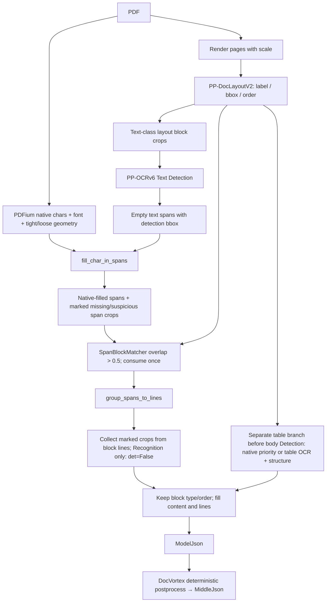

# MinerU 源码级 Extraction 与数据融合分析

日期：2026-09-21。范围：静态源码审计；没有安装 MinerU、下载模型、运行推理或 benchmark，也没有修改生产 ExtractionStage。

## 结论

**MinerU 的可移植设计是把“文字来源”和“结构来源”分开：layout 决定块类型、边界及顺序，native PDF 提供字符，Text Detection 提供可容纳字符的行/span 几何，仅缺字或异常 span 进入 Text Recognition。** 这证明 title / paragraph 等语义并不要求整页文字重新识别；但“可移植设计存在”不等于本项目 Challenger 已通过质量实验。

**MinerU auto 路由在所审计版本中是 document-level，不是每页独立决定 txt/ocr。** 4.x Basic 的 txt 路径仍可处理混合 PDF 的扫描区域，因为检测到的 span 填不进 native 字符时会做 span crop Recognition。Flash txt 完全绕过这条路径，没有扫描页 Recognition fallback。不能将这两者混为一谈。[4.x 模式选择][M-mode] [DocVortex 分类][D-classify] [native 回填][M-native] [post-recognition][M-fill]

## 1. 版本、安装与证据边界

| 对象 | 实际检查结果 | 本文使用方式 |
|---|---|---|
| 本地现有 MinerU | `/Users/liyuanxin/PyCharmMiscProject/MinerU`；`mineru/version.py` 和其 `.venv/.../mineru-*.dist-info/METADATA` 均为 **3.4.0**；git HEAD **3e60291846cb7c3bf8fe7f4f16238f4fc6cce491**，2026-06-18；只有既有 `uv.lock` untracked | legacy pipeline / legacy hybrid 证据 |
| 本次官方最新源码 | `/Users/liyuanxin/PyCharmMiscProject/rixin-contract-comparison/output/analysis/extraction-architecture-20260921/sources/MinerU-4.0.5`（本轮引用文件快照）；**4.0.5**；HEAD **94828a88d80ab8a72c21956de0604bf14f4cc9fc**，2026-09-20 | 4.0 系列的当前实现；不把它冒充 4.0.0 原始 tag |
| DocVortex 官方源码 | `/Users/liyuanxin/PyCharmMiscProject/rixin-contract-comparison/output/analysis/extraction-architecture-20260921/sources/DocVortex-0.4.21`（本轮引用文件快照）；**0.4.21**；HEAD **2e4ae7fb3e1d82ccf6152b0d6afad96d8eb2954e** | 追透 PDFDocument、Flash native、classification 和 middle_json；MinerU 4.0.5 要求 `docvortex>=0.4.20,<1` |

官方 4.0.0 发布记录为 2026-09-16；本次又以 git 和官方 commit 页面核验了最新 4.0.5。旧安装与新仓库均保留，没有替换环境。DocVortex 不是本次研究中的闭源 wheel；已读其官方公开源码。不过依赖是版本区间，**本报告对 DocVortex 0.4.21 的结论不能无条件推广到任意 `<1` 版本**。[官方发布记录](https://github.com/opendatalab/MinerU/releases) [4.0.5 commit](https://github.com/opendatalab/MinerU/commit/94828a88d80ab8a72c21956de0604bf14f4cc9fc) [依赖声明][M-deps] [DocVortex commit](https://github.com/myhloli/docvortex/commit/2e4ae7fb3e1d82ccf6152b0d6afad96d8eb2954e)

下文 M 链接固定到 MinerU 4.0.5 commit，L 链接固定到本地 3.4.0 commit，D 链接固定到 DocVortex 0.4.21 commit。所有行号来自这些固定源码，不引用浮动 main 作为行为证据。

## 2. 各模式不能互相替代

| 模式 | 结构来源 | 常规正文来源 | Text Detection / Text Recognition | 表格 |
|---|---|---|---|---|
| **4.x Flash txt** | DocVortex native 几何/字体/跨页统计与规则 | PDFium native characters | 不执行神经网络 Detection / Recognition；无扫描区补识别 | native 线条/字符/几何恢复；不调用表格识别模型 |
| **4.x Flash ocr** | PP-DocLayoutV2 | PP-OCRv6 | layout blocks crop Detection → detected lines Recognition | 表格 crop 独立 Detection+Recognition，投影为文本；不是 Basic 的有线/无线结构模型 |
| **4.x Basic txt** (`effort=medium`) | PP-DocLayoutV2 类型与顺序 | 检测出的 span 优先填 native chars | 仍做块区域 Detection；正文只补识别缺失/异常 span | 优先尝试 native table；失败/复杂表做表格 crop OCR + table structure |
| **4.x Basic ocr** | PP-DocLayoutV2 | PP-OCRv6 | 块区域 Detection → line crop Recognition | 表格 crop Detection+Recognition + 表分类/有线或无线结构识别 |
| **4.x Standard / Advanced** | 小模型 layout + VLM / 更高 effort VLM 流程 | txt 模式保留 native 优先；ocr 模式含 VLM 内容抽取 | 不能计为与 Basic 相同的 PP-OCRv6 一次；额外有 VLM、公式、印章、表格分支 | 按 effort、native 接受情况走 VLM/模型分支 |
| **3.4.0 legacy pipeline** | 小模型 PP-DocLayoutV2 | txt：native；ocr：Paddle recognition | Detection 与 Recognition 分离，txt 有 span post-recognition | 旧 pipeline 自己的表格分支 |
| **3.4.0 legacy hybrid** | 小模型 layout + VLM | txt：跳过指定 VLM 文本提取并填 native；ocr：VLM 内容 | txt 有 Detection + span post-recognition；ocr 的文本来自 VLM，Detection sidecar 服务行几何 | VLM/旧 hybrid 流程；**不是 4.x Basic** |

4.x `parser/tier.py:12-17` 映射为 flash→flash、basic→medium、standard→high、advanced→xhigh；而本地 3.4.0 hybrid 的 medium 仍调用 `predictor.batch_extract_with_layout`，因此 **相同 `medium` 字符串跨版本含义不同**。[tier 映射][M-tier] [Flash OCR][M-flashocr] [Basic 主分支][M-window] [legacy hybrid][L-hybrid]

## 3. 4.x 文本 PDF：完整调用链

### 3.1 Flash txt：完全原生路径

```text
mineru.backend.analyze.doc_analyze
 → backend/analysis/pdf/pipeline.py:analyze_pdf
 → _prepare_analysis
     PDFDocument(file_bytes)
     parse_mode==auto ? PDFDocument.classify() : 使用显式模式
     effort==flash && parse_mode==txt → flash_txt_mode=True
 → window.py:process_pdf_windows
 → docvortex.analyzers.native.models.PdfModel.predict
 → native/pdf/pipeline.py:_analyze_native_document
     _collect_document_sources
       PDFDocument._extract_native_page
       native chars / font / geometry / image / vector / annotations
       get_lines_from_chars → _build_native_line_items
     _prepare_document_sources
     _classify_document_text（正文/标题跨页 profile）
     _finalize_prepared_page（段落、标题、表格、视觉块、顺序）
     _materialize_document_inline
 → MinerU _normalize_pdf_model_list → ModelJson
 → DocVortex model_json_to_middle_json → PageInfo / blocks
```

Flash txt 分支在 `window.py:715-727` 提前 return；不进入模型推理用的全页渲染窗口。仅为视觉块输出按需补图，不代表运行 Detection 或 Recognition。[Flash 入口][M-flashtxt] [PdfModel][D-pdfmodel] [native document 编排][D-nativepipe]

canonical text 来自 PDFium `FPDFText_GetUnicode`；同时读取 loose/tight char boxes、字符旋转、字体名字/flags/size/weight，并做可见性/对象证据处理。bbox 由 PDF 原生几何及布局合并产生，最终转为页面归一化坐标。标题是 native 规则推断：`_classify_document_text` 形成 body/title profile；`_classify_page_titles` 和 structural title 函数结合字体、行高、版面位置与章节规则生成 `doc_title` / `paragraph_title`。reading order 来自几何分栏/视觉组/XY-cut 等排序，不是字体抽取顺序直接透传。[字符读取][D-chars] [标题规则][D-titles] [块排序][D-order]

### 3.2 Basic txt：本项目最值得移植的路径

```text
PDF bytes
 → PDFDocument.classify()（document-level，只在 auto）
 → window._prepare_pdf_window
     PDF render → images + scale
     PPDocLayoutV2[ONNX/Torch].batch_predict
       类型 + block bbox + reading order
     native table priority（成功则 table.content=HTML；失败保留模型任务）
 → window._process_text_and_formulas
     公式分支（不是 Text Recognition）
     need_rec_img = parse_mode==ocr && effort==medium = False
     ocr._ocr_det
       _collect_ocr_det_crops（只选 PIPELINE_DET_TYPE 的 layout blocks）
       text_detector.batch_predict（Text Detection）
       detected text lines → bbox sidecars（此时不做正文 Recognition）
 → text/content._fill_window_block_content_and_lines
     _build_page_text_formula_spans（Detection bbox → _AnalyzeSpan）
     _fill_native_pdf_text_spans
       text/native.txt_spans_extract
         PDFPage.get_chars_with_geometry
         fill_char_in_spans（native chars → detected spans）
         不足/异常 span → _prepare_post_ocr_spans（裁图挂 span.image）
     _group_page_spans_by_block
       SpanBlockMatcher.collect_for_block → group_spans_to_lines
     _apply_window_post_ocr
       仅 span.image 列表 → ocr_model.ocr(det=False) → Recognition
     _apply_block_content_and_line_metadata
       保留原 block.type/order，填 block.content 和 lines
 → normalized ModelJson → DocVortex MiddleJson
```

具体入口是 `content.py:_fill_window_block_content_and_lines`，不是 4.x 的 `MagicModel`：4.x 当前主路径不再用旧的 MagicModel 类。`content.py:182` 的 `_fill_native_pdf_text_spans` 调用 `native.py:72` 的 `txt_spans_extract`；检测和识别分别在 `ocr.py:_ocr_det` 与 `_apply_ocr_rec_results`，txt 的补识别在 `content.py:_apply_window_post_ocr`。[窗口渲染/layout/文本流程][M-window] [Detection 与 Recognition][M-ocr] [回填/组块/补识别][M-fill]

## 4. 4.x 扫描 PDF：触发与执行顺序

`auto` 分类返回 `ocr` 或用户显式 `ocr` 时，模式用于整份当前输入文档。Basic / Flash ocr 均先全页 render，再 layout，再按 layout 文本区域裁剪做 Text Detection，再将检测行裁成 Recognition batch。**它们覆盖页面内应识别文本，但并非把整张页面直接送给识别器一次**。精确调用次数由 page、layout crops、detected lines、batch size 决定；“一个 PDF Recognition=1 次”只能表示覆盖轮数，不能表示神经网络 forward 次数。[模式选择][M-mode] [crop 收集与 det][M-ocr] [Flash OCR][M-flashocr]

模型底层已追到独立网络：

```text
HybridLocalModelContext.get_ocr_model
 → atom_model_init(AtomicModelName.OCR)
   ONNX:
     PPOCRv6ONNX
       TextDetectorONNX.batch_predict → _run_det_batch → session.run
       ocr(det=False) → TextRecognizerONNX.__call__ → session.run
   Torch:
     PytorchPaddleOCR(TextSystem)
       predict_det.TextDetector → self.net(inp)
       predict_rec.TextRecognizer → self.net(inp)（Recognition crop batch）
```

4.0.5 registry 锁定的常规 OCR 权重为 `ch_PP-OCRv6_tiny_det_infer.onnx` 和 `ch_PP-OCRv6_small_rec_infer.onnx`；Torch 配置对应 `.safetensors`。它不是 DocVortex VLM，也不能把这一 tiny/small 组合冒充本项目远端的实际模型规格。印章另有 `seal_PP-OCRv4_det` + PP-OCRv6 rec，不能把所有 Detector 都写为 v6。[初始化路由][M-models] [权重 registry][M-registry] [Torch 配置][M-torchcfg] [ONNX 独立网络实现][M-onnx] [Torch Detector][M-tdet] [Torch Recognizer][M-trec]

Basic tables 在正文外有 `_prepare_medium_table_ocr_results`，对 table crop 调 `.ocr(masked_image)`（Detection+Recognition），随后 table classification、SLANet 类无线结构识别、有线表结构分支。这是 **文字识别与表格结构识别两个任务**。Flash ocr 的 `_fill_flash_ocr_table_contents` 也对 table crop 调 OCR，但只把文字投影成 table content。不能说 MinerU 全文零重复，更不能忽略表格局部识别。[table 分支][M-tables]

## 5. 混合 PDF：document-level 分类 + span-level fallback

### 5.1 分类颗粒度的源码证明

`pipeline._prepare_analysis` 只调用一次 `state.document.classify()`，把结果放到 `state.parse_mode`；`process_pdf_windows` 给所有窗口传同一个 mode。DocVortex `PDFDocument.classify` 在实例中缓存 `_classification`；`document/pdf/classify.py:88` 抽样最多 10 页，综合平均 native 字符数、Unicode/字体映射/乱码信号、图像覆盖等返回**一个** `txt` 或 `ocr`。没有给每一页返回独立类型的数组。[M-mode] [D-document] [D-classify]

因此：若混合文档被归 `ocr`，native 很好的页也进入识别路径；若归 `txt`，不同 tier 的 fallback 行为不同。给定页码范围预先产生的子文档，分类作用域是传入的那个 PDF，不应误写成永远整份原始文件。

### 5.2 Basic txt 如何发现扫描区

它不需要先标记“这是一张扫描页”。layout 在 render 图像中找到 text/title 等区域，Text Detection 找到行 bbox；native 填字后，`fill_char_in_spans` 判定：

- `len(span.content) * span.height < span.width * 0.5`：内容相对于几何宽度不足，含空 span。
- PUA 私用区字符达到数量/连续长度/比例阈值：内容可疑，保留 native fallback content 后申请补识别。
- native page char count 超上限：该页检测出的 text spans 统一准备补识别，**执行单位仍是 span crop**。

`_prepare_post_ocr_spans` 对 crop 做对比度过滤（`<0.17` 不识别）；剩余 crop 在 `_apply_window_post_ocr` 调 `.ocr(det=False)`。所以扫描页可能多数 span 都需要 Recognition；文本页可能零个或少数。它是**page 遍历内的 span fallback**，不是重新对整个页面跑 Detection+Recognition。表格失败则另有 table-level fallback。[M-native] [M-fill] [M-tables]

这不是完备保证：如果 layout 未检出该区、Detection 漏行、过滤丢框或字符虽错误却通过质量阈值，该区仍可能缺失。源码证明 fallback 机制存在，不能代替合同样本验证。

### 5.3 Flash txt 的行为

Flash txt 不调用上述 Detection/native 填 span/post-recognition 代码。扫描页原生无文字时，无法靠它恢复扫描图上的正文；可能留下图像/视觉块，但不产生扫描文字。其文档级分类即使总体判为 txt，也不会给漏掉的扫描页自动做 OCR。官方快速入门与代码一致。[M-flashtxt] [官方 Flash txt 说明](https://opendatalab.github.io/MinerU/quick_start/)

## 6. 4.x 数据融合：谁决定每个字段

| 字段/结构 | Basic txt 的真实来源 | 重要边界 |
|---|---|---|
| canonical text | native PDF characters 优先；缺失/异常 span Recognition 替补 | 不是无条件将 OCR 字符覆盖 native |
| layout type | PP-DocLayoutV2 label → `VLM_LAYOUT_LABEL_MAP` | `doc_title` / `paragraph_title` / `text` / `table` 在填字前已有 |
| title | Basic 直接来自 layout label；VLM 通用 title 额外用 layout doc_title overlap 拆分 | title classification 不依赖整页 Text Recognition；title level 与 title type 不等同 |
| block bbox | layout 像素 bbox → `[0,1]` 页面坐标 | 不从文本 string 重建 |
| span/line bbox | Text Detection bbox → PDF point bbox；字符另有 native tight/loose box | 必须管理 render scale、rotation、单位 |
| reading order | PP-DocLayoutV2 order head / ONNX order keys → 已排序 block list | 字符填充保留 block list 顺序 |
| paragraph | block type/行合并后再由 DocVortex paragraph 后处理 | 不是把整个页面 native text 拼成一个段 |
| font info / char boxes | PDFPage native 几何可用于回填与样式证据 | 不代表最终 middle_json 完整保存原生每字符证据 |
| table structure | native table recovery 成功的 HTML，或表格模型结果 | layout-only 只给 table 区域，不自动产生 cell/row/col 结构 |

[M-layout] [M-constants] [M-order] [M-orderonnx] [M-fill] [M-titles] [D-pages]

真实融合图：



`SpanBlockMatcher.collect_for_block` 按 block 原始顺序消费 span，以 span 面积落入 block 的比例 `>0.5` 归属，使用 `used_span_indices` 防重复；`_group_page_spans_by_block` 再组行；`_apply_block_content_and_line_metadata` 只在原块没有非空 content 时写入拼接内容。**这是有边界和优先级的融合，不是把 native 与 OCR 两套文字无差别拼接。**[M-native] [M-fill]

4.x `ModelJson` 最终交给 `docvortex.postprocess.document.model_json_to_middle_json`，经 `model_json_to_pages`、`process_page_blocks`、段落与跨页表格合并。`pages.py:_remove_private_block_metadata` 会清理 `lines`、`_lines`、`angle`、`score` 等临时字段；几何还存在 layout extension，但**不能假设 middle_json 能替代本项目所需 char-box/line 证据契约**。本项目应保留 Unified Page Artifact，再生成业务 blocks。[M-output] [D-middle] [D-pages]

## 7. 本地 legacy 3.4.0：MagicModel 在哪里

### legacy pipeline

```text
pipeline_analyze.doc_analyze_streaming
 → _get_ocr_enable(pdf_bytes, parse_method) → classify(pdf_bytes)（文档级）
 → render → BatchAnalyze.__call__
 → PPDocLayoutV2 → Detection（rec=False 或 text_detector.batch_predict）
 → ocr_enable 时收集 Recognition crops → ocr(det=False)
 → model_json_to_middle_json.page_model_info_to_page_info
 → pipeline_magic_model.MagicModel
     __fix_axis / __post_process
     !ocr_enable → txt_spans_extract(native chars → spans)
     layout label → block type；按 index 排序
     __build_page_blocks / SpanBlockMatcher
 → _apply_post_ocr（仅挂有 np_img 的 spans，det=False）
 → finalize_middle_json
```

源码定位：`pipeline_analyze.py:88,157`；`batch_analyze.py:408` 开始的 `__call__`、正文 Detection 约 759/827 行、Recognition 约 883 行；`pipeline_magic_model.py:70-126`；`model_json_to_middle_json.py:148-193`。同样是 native + Detection geometry + layout semantics + 局部 Recognition，不是 native text 不可用。[L-pipeline] [L-batch] [L-magic] [L-post]

### legacy hybrid

`hybrid_analyze.ocr_classify` 文档级决定 `_ocr_enable`。旧 medium 调 `predictor.batch_extract_with_layout`，旧 high 调 `batch_two_step_extract`；txt 时用 `not_extract_list` 跳过指定正文 VLM 提取，随后 `_process_ocr_and_formulas` 提供 Detection sidecar。`hybrid_magic_model.MagicModel.__init__` 分离 page blocks、inline formulas、OCR results，将 Detection result 转 span；`!_ocr_enable` 时用 `txt_spans_extract` 写入 native text，再 `SpanBlockMatcher` 分配到保有 VLM/layout 类型的块。最终 `hybrid_model_output_to_middle_json._apply_post_ocr` 只对挂图 span `.ocr(det=False)`；`apply_server_side_postprocess` 仅在 txt 启用该 post-recognition。[L-hybrid] [L-hmagic] [L-hpost]

旧 hybrid ocr 由 VLM 做文本内容抽取，另跑 Detection 生成行几何；不能拿旧 hybrid 的“开启 OCR”布尔值当作“调用一次 PP-OCR 文字识别”的证据。**旧 pipeline、旧 hybrid、4.x Basic 的结构/识别调度不同，即使都生成 middle_json。**

## 8. 对 Contract Extraction Challenger 的可移植结论

可直接借鉴的架构边界：

1. **Page Profiler 单独逐页决定 NATIVE_GOOD / MIXED / SCANNED**。这优于照抄 MinerU 的文档级 txt/ocr 开关，避免少数扫描页迫使整文件 Recognition。
2. **Layout-only 始终保留语义职责**：title、paragraph/text、table、header/footer、block bbox、reading order。native extraction 填 canonical text，不能把类型全部硬编码成 text。
3. **布局框和文本行框分工**：第一版先将可信 native lines/chars 投影到 layout blocks；遇到覆盖缺口，再调用 Detection 找行，只有不足的 span/region 调 PP-OCRv6 Recognition。
4. **Recognition 按 region/span 去重**：明确记录文字来源、识别原因、parent layout id、坐标转换、模型 identity。表格文字可复用已有 native/OCR tokens，结构单独恢复；必要的 table crop Recognition 单独计数。
5. **Unified Page Artifact 保留 native chars/font/line hierarchy、layout semantics/order、table cells 与 evidence**，不要盲从 MinerU 导出 JSON 的字段清理行为。

需要特别说明：MinerU Basic 的现成证明是 **native + layout + Text Detection + 按需 Recognition**。它不是“native + layout-only 在所有合同上足够”的证明。移植版可以在 NATIVE_GOOD 上尝试跳过 Text Detection，但必须用后续最小实验验证行/段落/几何覆盖；不能在架构报告里先宣告通过。

## 9. 最小实验建议（未执行）

只选已有 Native Fast Path 失败合同中包含标题、长段落和表格的代表页，外加一页扫描页与一页同页混合文字。冻结 baseline extraction，并创建离线 Challenger artifacts：native chars/lines + layout-only 输出，做坐标归一、span/block 归属、type/order 恢复；缺口仅补 region Detection / span Recognition。保持生产 ExtractionStage 不变。

逐字段比较 text、bbox、page、block_type、title、paragraph、table、reading_order、font、line hierarchy、char boxes，并将同一份恢复后的 Document 送入现有 ClauseSplitter（仅验证，不优化）。过关证据必须包括：原本 title→text 的块恢复为预期 title；原 section 边界不继续合并；最长 clause 不出现 50,191 级异常；文本无新增缺失/重复；完整页 Recognition 覆盖轮数、span 次数和 table 次数分别报告。先证明结构恢复，再决定是否扩大到 A–E benchmark。

## 固定源码链接

[M-deps]: https://github.com/opendatalab/MinerU/blob/94828a88d80ab8a72c21956de0604bf14f4cc9fc/pyproject.toml#L42
[M-tier]: https://github.com/opendatalab/MinerU/blob/94828a88d80ab8a72c21956de0604bf14f4cc9fc/mineru/parser/tier.py#L12-L25
[M-mode]: https://github.com/opendatalab/MinerU/blob/94828a88d80ab8a72c21956de0604bf14f4cc9fc/mineru/backend/analysis/pdf/pipeline.py#L40-L64
[M-flashtxt]: https://github.com/opendatalab/MinerU/blob/94828a88d80ab8a72c21956de0604bf14f4cc9fc/mineru/backend/analysis/pdf/window.py#L701-L727
[M-flashocr]: https://github.com/opendatalab/MinerU/blob/94828a88d80ab8a72c21956de0604bf14f4cc9fc/mineru/backend/analysis/pdf/window.py#L146-L194
[M-window]: https://github.com/opendatalab/MinerU/blob/94828a88d80ab8a72c21956de0604bf14f4cc9fc/mineru/backend/analysis/pdf/window.py#L197-L535
[M-ocr]: https://github.com/opendatalab/MinerU/blob/94828a88d80ab8a72c21956de0604bf14f4cc9fc/mineru/backend/analysis/pdf/ocr.py#L72-L263
[M-native]: https://github.com/opendatalab/MinerU/blob/94828a88d80ab8a72c21956de0604bf14f4cc9fc/mineru/backend/analysis/pdf/text/native.py#L72-L617
[M-fill]: https://github.com/opendatalab/MinerU/blob/94828a88d80ab8a72c21956de0604bf14f4cc9fc/mineru/backend/analysis/pdf/text/content.py#L182-L500
[M-models]: https://github.com/opendatalab/MinerU/blob/94828a88d80ab8a72c21956de0604bf14f4cc9fc/mineru/model/runtime/hybrid.py#L230-L299
[M-registry]: https://github.com/opendatalab/MinerU/blob/94828a88d80ab8a72c21956de0604bf14f4cc9fc/mineru/model/registry.py#L43-L58
[M-torchcfg]: https://github.com/opendatalab/MinerU/blob/94828a88d80ab8a72c21956de0604bf14f4cc9fc/mineru/model/_internal/pytorchocr/utils/resources/models_config.yml#L1-L9
[M-onnx]: https://github.com/opendatalab/MinerU/blob/94828a88d80ab8a72c21956de0604bf14f4cc9fc/mineru/model/ocr/pp_ocr_v6_onnx.py#L64-L482
[M-tables]: https://github.com/opendatalab/MinerU/blob/94828a88d80ab8a72c21956de0604bf14f4cc9fc/mineru/backend/analysis/pdf/tables.py#L201-L1029
[M-layout]: https://github.com/opendatalab/MinerU/blob/94828a88d80ab8a72c21956de0604bf14f4cc9fc/mineru/backend/analysis/pdf/layout.py#L25-L106
[M-constants]: https://github.com/opendatalab/MinerU/blob/94828a88d80ab8a72c21956de0604bf14f4cc9fc/mineru/backend/analysis/pdf/constants.py#L74-L133
[M-order]: https://github.com/opendatalab/MinerU/blob/94828a88d80ab8a72c21956de0604bf14f4cc9fc/mineru/model/layout/pp_doclayoutv2.py#L93-L180
[M-titles]: https://github.com/opendatalab/MinerU/blob/94828a88d80ab8a72c21956de0604bf14f4cc9fc/mineru/backend/analysis/pdf/normalization.py#L44-L64
[M-output]: https://github.com/opendatalab/MinerU/blob/94828a88d80ab8a72c21956de0604bf14f4cc9fc/mineru/backend/postprocess/document.py#L5-L25
[D-document]: https://github.com/myhloli/docvortex/blob/2e4ae7fb3e1d82ccf6152b0d6afad96d8eb2954e/src/docvortex/document/pdf/_document.py#L695-L699
[D-classify]: https://github.com/myhloli/docvortex/blob/2e4ae7fb3e1d82ccf6152b0d6afad96d8eb2954e/src/docvortex/document/pdf/classify.py#L17-L225
[D-pdfmodel]: https://github.com/myhloli/docvortex/blob/2e4ae7fb3e1d82ccf6152b0d6afad96d8eb2954e/src/docvortex/analyzers/native/models.py#L13-L23
[D-nativepipe]: https://github.com/myhloli/docvortex/blob/2e4ae7fb3e1d82ccf6152b0d6afad96d8eb2954e/src/docvortex/analyzers/native/pdf/pipeline.py#L314-L544
[D-chars]: https://github.com/myhloli/docvortex/blob/2e4ae7fb3e1d82ccf6152b0d6afad96d8eb2954e/src/docvortex/document/pdf/text/extract.py#L113-L207
[D-titles]: https://github.com/myhloli/docvortex/blob/2e4ae7fb3e1d82ccf6152b0d6afad96d8eb2954e/src/docvortex/analyzers/native/pdf/title_analysis/page_titles.py#L24-L87
[D-order]: https://github.com/myhloli/docvortex/blob/2e4ae7fb3e1d82ccf6152b0d6afad96d8eb2954e/src/docvortex/analyzers/native/pdf/pipeline.py#L1100-L1286
[D-middle]: https://github.com/myhloli/docvortex/blob/2e4ae7fb3e1d82ccf6152b0d6afad96d8eb2954e/src/docvortex/postprocess/document.py#L10-L17
[D-pages]: https://github.com/myhloli/docvortex/blob/2e4ae7fb3e1d82ccf6152b0d6afad96d8eb2954e/src/docvortex/postprocess/pages.py#L26-L95
[L-pipeline]: https://github.com/opendatalab/MinerU/blob/3e60291846cb7c3bf8fe7f4f16238f4fc6cce491/mineru/backend/pipeline/pipeline_analyze.py#L88-L94
[L-batch]: https://github.com/opendatalab/MinerU/blob/3e60291846cb7c3bf8fe7f4f16238f4fc6cce491/mineru/backend/pipeline/batch_analyze.py#L407-L919
[L-magic]: https://github.com/opendatalab/MinerU/blob/3e60291846cb7c3bf8fe7f4f16238f4fc6cce491/mineru/backend/pipeline/pipeline_magic_model.py#L70-L126
[L-post]: https://github.com/opendatalab/MinerU/blob/3e60291846cb7c3bf8fe7f4f16238f4fc6cce491/mineru/backend/pipeline/model_json_to_middle_json.py#L148-L234
[L-hybrid]: https://github.com/opendatalab/MinerU/blob/3e60291846cb7c3bf8fe7f4f16238f4fc6cce491/mineru/backend/hybrid/hybrid_analyze.py#L910-L1060
[L-hmagic]: https://github.com/opendatalab/MinerU/blob/3e60291846cb7c3bf8fe7f4f16238f4fc6cce491/mineru/backend/hybrid/hybrid_magic_model.py#L45-L112
[L-hpost]: https://github.com/opendatalab/MinerU/blob/3e60291846cb7c3bf8fe7f4f16238f4fc6cce491/mineru/backend/hybrid/hybrid_model_output_to_middle_json.py#L127-L254

[M-orderonnx]: https://github.com/opendatalab/MinerU/blob/94828a88d80ab8a72c21956de0604bf14f4cc9fc/mineru/model/layout/pp_doclayout_v2_onnx.py#L103-L146
[M-tdet]: https://github.com/opendatalab/MinerU/blob/94828a88d80ab8a72c21956de0604bf14f4cc9fc/mineru/model/_internal/pytorchocr/infer/predict_det.py#L194-L225
[M-trec]: https://github.com/opendatalab/MinerU/blob/94828a88d80ab8a72c21956de0604bf14f4cc9fc/mineru/model/_internal/pytorchocr/infer/predict_rec.py#L284-L424
