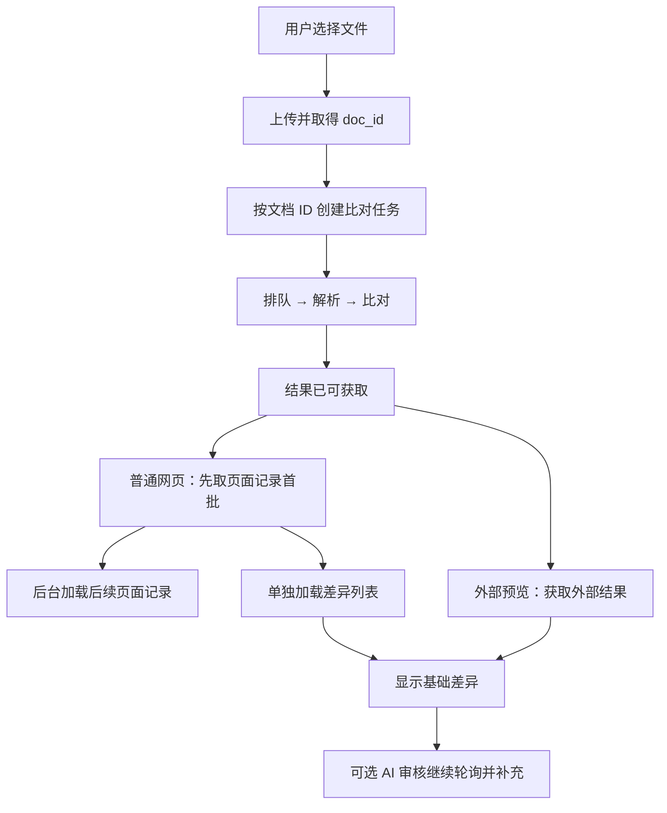

# TextIn 处理过程深度分析：识别、比对与首屏等待

研究日期：2026-09-16。对象：TextIn 合同比对产品及其公开前端；xParse 仅作为相邻解析产品的技术证据。本轮没有修改业务代码或提交新的在线比对任务。

## 1. 结论

**当前差距主要在扫描解析、匹配工作量和额外视觉处理。基础文字 diff 已经很快，继续优化这一小段几乎没有收益。**

TextIn 的公开接口、前端代码和保存响应可以共同还原其外部处理链：上传文件、创建任务、排队、解析、比对、获取结果、分批展示页面和差异、继续补充可选 AI 审核。内部的具体对应算法、模型调用次数和集群配置仍未公开。

本轮比已有研究新增三项直接证据：

1. **展示与后续审核分开。** 官方当前前端的普通结果页先获取最多 50 条页面记录，再后台获取剩余记录；差异列表单独请求；AI 审核状态另行轮询。不是所有工作都完成才显示第一屏。外部 API 预览走另一条加载分支，不能把普通页面的分批行为直接套用到它。
2. **优化后的本地瓶颈已经变化。** 最新保存的长合同真实服务复验约 148.43 秒，解析约 88.99 秒，解析之后约 59.21 秒。其中“差异计算中”仅约 0.006 秒，“汇总统计中”却约 10.53 秒，后者主要在执行图形检查。
3. **减少全量模型匹配有实际空间。** 对保存的匹配输入做只读筛查，367 条原文中有 286 条可形成保守的相同文本对应，全部与保存的 matcher 结果一致；现有流程却仍执行 367 组 rerank。该结果是研究探针，不是新的匹配实现或质量验收。

这三项分别影响首屏体验、解析关键路径和配对计算。不能把它们合成一个没有实测依据的“优化后 20 秒”承诺。

## 2. 证据范围与计时校正

本轮重新读取了官方 API 文档，下载并检查了当前公开网页引用的 JavaScript，复核了两份保存的 TextIn 原始响应，以及本项目最近一次优化后的真实服务记录。新脚本、来源 URL、内容哈希和统计保存在 [研究证据目录](../../output/analysis/textin-processing-20260916/)。

| 证据 | 可以说明什么 | 不能说明什么 |
|---|---|---|
| 官方合同比对 API | 输入开关、异步状态、响应结构和计时字段 | 服务端内部函数、队列、GPU 数量 |
| 当前公开前端代码 | 上传/创建顺序、轮询、分页、展示和审核分离 | 某次真实任务的网络时间、后台缓存命中 |
| 保存的两份 TextIn 响应 | 该输入的结果和服务端报告时间 | 稳定 P95、冷启动时间、所有样本的准确率 |
| xParse 官方工程文章 | 厂商公开的页面并行、模型轻量化路径 | 合同比对一定使用同一版本与集群 |
| 本地只读匹配探针 | 相同文本对应的潜在覆盖率 | TextIn 采用该算法，或可直接删除模型调用 |

本地已有 12 组合成实验、计划 24 个外部任务，但状态仍为 `awaiting_credentials`、已创建任务为 0。本轮检查的进程环境和项目 `.env` 未提供所需 TextIn 凭据，因此没有把“已准备实验”写成“实测 TextIn 行为”。历史两份响应继续作为已完成实验的证据。

### 同输入的保存记录

| 样本 | 本地流水线 | 本地外层计时 | 本地解析阶段 | 本地解析后 | TextIn 解析 | TextIn 比对 | TextIn 两字段和 |
|---|---:|---:|---:|---:|---:|---:|---:|
| 55＋54 页 | 148.202 s | 148.431 s | 88.991 s | 59.211 s | 20.107 s | 1.384 s | 21.491 s |
| 22＋22 页 | 48.075 s | 48.256 s | 27.536 s | 20.539 s | 7.790 s | 0.960 s | 8.750 s |

本地数据来自 2026-09-15 最后一次优化后的真实服务复验，不是本轮重跑，也不能等同当前生产实例已经部署的性能。此前 171、179、206 秒分别属于不同代码/运行快照，不应混作当前单一基线。来源：[复验汇总](../../output/analysis/performance-implementation-20260915/live-quality-and-performance.json)、[本轮重算](../../output/analysis/textin-processing-20260916/local-audit.json)。

TextIn 的 `parse_duration`、`compare_duration` 单位是毫秒；官方没有给出上传、排队、结果保存和可选审核是否包含在内的完整埋点边界。两字段和只是相加，不能认定等于用户从选文件到看到结果的完整等待。[官方字段说明](https://www.textin.com/document/doc-compare-diff-info)

## 3. 能直接观察到的 TextIn 流程



这张图描述公开客户端的消费顺序，不是对服务端微服务拓扑的猜测。

### 3.1 文件上传与创建任务是两个动作

创建页组件在选定文件后调用 `/comparison/upload`，保存返回的 `doc_id`；另一个调用通过 `/comparison/create_with_doc_id` 提交标准件、对比件与比对选项。代码也保留携带文件直接调用 `/comparison/create` 的路径。[创建页代码](https://contracts.textin.com/textin_for_contracts/js/4669.e645035c.js)、[API 封装](https://contracts.textin.com/textin_for_contracts/js/3943.d44e0ed3.js)

**影响：**如果只从点击“开始比对”计时，可能遗漏此前上传等待。已有 `doc_id` 证明文件身份可复用，但不能单凭它证明 OCR 已在上传时开始，也不能证明跨任务解析缓存命中。要验证后两点，需要上传阶段的服务日志或受控冷暖实验。

### 3.2 排队、解析、比对有独立状态

列表代码区分 `PENDING=0`、`PARSING=2`、`COMPARING=3`、`SUCCESS=1`，同时区分解析失败和比对失败。列表在有排队任务时约 1.5 秒刷新一次，在其他进行中状态约 3.5 秒刷新一次。这说明产品把排队、解析和比对呈现为不同状态，不说明后台使用了哪种队列。[列表代码](https://contracts.textin.com/textin_for_contracts/js/8736.3a1a782e.js)

上传组件的进度数字由前端定时增长，到上传响应成功后置为完成。它不能用于反推出 GPU 利用率、真实识别进度或单页完成时间。[创建页代码](https://contracts.textin.com/textin_for_contracts/js/4669.e645035c.js)

### 3.3 普通结果页分开获取页面与差异

`getResultByNormal` 先用 `return_type=1`、`page=1`、`page_size=50` 请求页面记录，完成首批初始化后解除主加载状态；余下记录通过 `loadRemainingPages` 获取。同时用 `return_type=2` 请求差异列表。这里的 50 是分页请求的记录数，不能认定是“先处理 50 页 PDF”。[结果页代码](https://contracts.textin.com/textin_for_contracts/js/5714.ae0beb40.js)

前端预览按视口绘制页面，配置相邻页预取，并复用已加载图片。它可以缩短打开结果的等待，却不会让 OCR 推理本身变快。[预览组件](https://contracts.textin.com/textin_for_contracts/js/7415.bf581a53.js)

外部 API 预览的 `getResultByApi` 使用外部结果接口；收到“处理中”码时约 5 秒后再取。因此，“网页首屏快”“外部预览完成”“服务端比对耗时”是三个不同指标。

### 3.4 基础差异不必等待可选 AI 审核

结果页有独立的 `ai_review_status` 和 `startPolling`。基础结果加载后继续读取重要程度、原因和忽略状态等信息，轮询间隔在约 2～4 秒之间。公开代码足以支持“基础比对与后续审核状态分开消费”，不能据此判断审核使用哪个模型、何时在服务端启动。[结果页代码](https://contracts.textin.com/textin_for_contracts/js/5714.ae0beb40.js)

厂商 FAQ 另行说明，本地部署基础合同比对不要求部署大模型。这与可选 AI 审核分离相容；不代表 OCR 不使用神经网络，也不代表公有云完全没有 embedding 或 rerank。[合同比对 FAQ](https://b.intsig.com/news/20251017174841309)

## 4. 解析阶段：TextIn 的快来自哪里

### 4.1 电子 PDF 与扫描件有不同处理入口

合同比对 API 的 `use_pdf_parser` 默认开启，关闭时使用 OCR。水印擦除单独配置，官方明确说明它会增加解析时间。保存的两份请求均开启 PDF 解析、关闭水印擦除。[创建接口](https://www.textin.com/document/doc-compare-create)

长合同原文 55 页中有 52 页具备较完整文字层，而对比件 54 页中只有 1 页达到已有探针的文字量门槛。原文可以利用电子文字，对比件仍主要依赖图像。这解释了可节省的一部分工作，但如果扫描侧仍是最慢分支，仅加速电子侧不一定缩短最终等待。[既有文字层与耗时证据](../../output/analysis/textin-speed-20260915/timing-evidence.json)

合理的解析链路是：读取文件及页信息，按输入能力选择文字提取/图像识别，定位文本与表格等元素，恢复阅读顺序，形成带来源位置的结构化结果。**合同比对路由到底发生在文件、页面还是区域层，公开接口无法确认。**

### 4.2 官方披露的是页面级并行与模型轻量化

xParse 的官方技术说明披露了单页任务拆分、多节点负载分配、并行解析后合并，以及模型蒸馏和减少重复预处理。这为其高吞吐提供了具体工程解释。[官方工程说明](https://www.textin.com/news/20251106195842085)

本项目已经把两份文档、两种提取组件并行调用；它解决的是客户端请求并发。TextIn 上述设计解决的是一份多页文档内部的调度。四个 HTTP 请求若最终竞争同一组推理资源，增加请求线程不会自动提高单任务速度。

可用下面的模型理解长文档延迟：

```text
解析等待 = 排队 + 文件/页面准备
         + 最慢工作节点承担的页面任务
         + 跨页结构整合与结果保存
```

具体有多少工作节点、是否批推理、采用哪些模型，当前没有证据。xParse 的“百页 2 秒”宣传也不能直接当作合同比对的速度；合同比对 FAQ 自身给出的是分钟级百页口径，产品与测量条件不同。

### 4.3 解析能力是可选择的，不是固定堆叠所有功能

xParse 文档区分电子解析、扫描解析、轻量模式和视觉语言模型模式，并允许配置表格、图像等输出。其规范还提供每页 DPI、耗时和状态字段。这说明相邻解析产品具备按任务选择处理路径和观察页级行为的接口，但不是合同比对接口可直接使用的参数。[解析配置](https://docs.textin.com/xparse/v1/parse-config)、[解析 API](https://docs.textin.com/api-reference/endpoint/parse)

对本项目，应先查 PP-Structure 服务端如何处理每页，而不是只看总 HTTP 时间。最新长样本扫描侧 PP-Structure 请求约 87.43 秒、独立 PP-OCRv5 请求约 56.56 秒，整体解析约 88.99 秒，最慢分支非常明确。

PP-StructureV3 官方结构本身包含通用 OCR 子流程。当前项目又独立请求一份 PP-OCRv5 结果再做融合，存在识别工作重叠的结构性可能；实际重复了哪些推理、是否共享服务端缓存，必须核查部署配置，不能仅凭客户端推断。[PaddleX 官方结构说明](https://paddlepaddle.github.io/PaddleX/3.2/en/pipeline_usage/tutorials/ocr_pipelines/PP-StructureV3.html)、[本地混合提取器](../../backend/app/services/extractors/ppstructure_ocr_hybrid.py)

正确的优化目标是让基础识别产物可复用、困难区域按需补识别。现有双路输出承担文本纠错、字符定位和结构补全作用，直接删掉其中一路可能改变差异结果。

### 4.4 缓存有公开线索，尚无该样本命中证据

xParse 文档建议通过稳定的 `file_id` 缓存处理结果；计费文档说明 Web 平台保存解析结果。它们不能证明合同比对内部采用同样的缓存，更不能解释本项目保存的 20.107 秒一定是热缓存。[缓存建议](https://docs.textin.com/xparse/v1/parse-config)、[Web 与 API 说明](https://docs.textin.com/xparse/charge)

## 5. 比对阶段：为什么 1.4 秒并不神秘

### 5.1 先获得结构化对象，再比较，计算量可以很小

TextIn 返回的不只有字符串：对象带类型、页码、文本位置，表格还有行/单元格归属与子差异。保存的长样本含文本、图片、印章、表格和单元格事件，足以确认结果保留元素结构。[差异接口](https://www.textin.com/document/doc-compare-diff-info)、[已保存响应结构统计](../../output/analysis/textin-internals-20260915/response-audit.json)

一个与输出相容的内部流程是：

1. 按阅读顺序组织文本与结构元素，处理配置要求忽略的内容。
2. 确定两侧元素对应关系，处理插入、删除、跨页或拆并。
3. 对已经配对的文本做局部字符比较；表格、印章走适合其类型的规则。
4. 将差异文字投影回位置，合并成可展示事件。

**这是有依据的流程推断，尚未证实 TextIn 实际采用的顺序。**“先全文比较再映射到元素”也能产生类似结果；不能从 JSON 或耗时直接认定它使用 Myers、LCS、某种动态规划或完全不调用语义模型。

### 5.2 本项目慢在先找对应关系，而非最后比较字符

最新长样本的文字差异阶段只有约 6 毫秒。此前则生成 37,903 个候选对，发送 23 次 embedding 请求、367 次 rerank 请求，后者覆盖 11,010 个候选文本。

位置召回来源覆盖 36,885 个候选对；来源之间会重叠，不能与其他来源直接相加。这个量接近全部候选数，说明当前仍在比较很宽的候选范围，即使页面已经基本对齐。`unambiguous_exact_groups=0` 也与未启用相同文本快速处理的当前配置相符。[最新匹配计数](../../output/analysis/textin-processing-20260916/local-audit.json)

模型评分可能对移动条款、OCR 错误和拆分条款有帮助，但对所有明显相同的正文都执行同样重排，收益与成本并不匹配。不能把“保留语义能力”等同于“所有条款都经过语义重排”。

### 5.3 本轮验证了相同文本锚点的覆盖空间

筛查规则：原始 `text` 仅移除空白后完全相同，至少 20 字符，两侧均只出现一次；至少有一个可靠的一对一对应页；`section_type` 和 `clause_no` 相同。保留数字和标点，不做同义替换。

| 指标 | 长合同 | 短合同 |
|---|---:|---:|
| 原文 / 比对条款数 | 367 / 363 | 73 / 104 |
| 双侧唯一的相同文本 | 287 | 58 |
| 通过页关系与结构条件 | 286 | 45 |
| 与保存 matcher 对应关系一致 | 286 / 286 | 45 / 45 |
| 锚点次序交叉数 | 0 | 0 |
| 尚未被覆盖的原文条款 | 81 | 28 |
| 筛查计算中位数，10 次，不含 JSON 加载 | 约 1.9 ms | 约 0.3 ms |

长合同约 77.9% 的原文条款可成为进一步优化的锚点候选。若完整验证通过，理论上重排组数可以从全量 367 组向剩余 81 组收缩；这只是请求数量的机会估计，不是整任务加速 77.9%。

该实验没有改变候选召回、全局分配或实际差异输出，也未执行优化后的完整流程。“与原 matcher 相同”仅证明对应关系一致，不证明原 matcher 一定正确。锚点只用于帮助配对，不能据此跳过原始文本的变化检查，尤其是数字、标点和需要保留的空白变化。

复现：`.venv/bin/python output/analysis/textin-processing-20260916/audit_local.py`。结果保留输入哈希与对应条款 ID，不复制合同正文。

### 5.4 合并差异与判断差异是不同环节

官方 `merge_diff` 控制差异合并；当前网页另有 `merge_layout_diff` 结果请求参数。可以确认产品有展示粒度控制，不能认定两个参数完全等价，也不能据此证明开关只改变前端。[创建 API](https://www.textin.com/document/doc-compare-create)、[结果页代码](https://contracts.textin.com/textin_for_contracts/js/5714.ae0beb40.js)

已有长样本存在相同差异载荷附着到不同元素的现象。因此事件数变化可能来自分组，而非识别出更多真实修改。速度与正确性对照必须看覆盖的文字、对象身份与坐标，不能只比较最终条数。

## 6. 本项目的其余等待也必须处理

最新长合同完整流水线的阶段时间如下。采用外层阶段计时；先前报告中的 5.96 秒页面对齐、15.93 秒匹配是组件内部计时，包含范围略小。

| 阶段 | 时间 | 对理解速度差的意义 |
|---|---:|---|
| 文档解析 | 88.99 s | 扫描侧 PP-Structure 是最慢远端分支 |
| 文档准备 | 11.02 s | 包含角色恢复、原生文字/表格补全与视觉检查 |
| 页面对齐 | 6.17 s | 已显著优化，但仍有计算成本 |
| 表格等差异识别，两段合计 | 7.00 s | 类型处理与切分等，不是最终字符串 diff |
| 签章区域识别 | 7.64 s | 专门的视觉与结构判断 |
| 条款匹配 | 16.29 s | 广候选评分、向量及重排 |
| 文字差异计算 | 0.006 s | 已不是主要瓶颈 |
| 汇总统计 | 10.53 s | 内含约 10.37 秒的矩阵图形检查 |
| 其他阶段 | 约 0.54 s | 定位、质量检查等 |

矩阵图形检查本次扫描 109 页；全任务的页面渲染缓存记录 245 次未命中、38 次命中，渲染操作累计约 8.90 秒。不同尺寸、颜色模式和裁剪可能需要不同渲染，245 次并不等于重复了 245 次同一工作。[图形检查实现](../../backend/app/services/matrix_graphics.py)、[阶段计数](../../output/analysis/textin-processing-20260916/local-audit.json)

**这些内部操作已包含在阶段与总时间中，不能再叠加。**例如 10.37 秒图形检查几乎包含在 10.53 秒汇总中；8.90 秒渲染分散在相关阶段，并不是总时长之外的额外时间。

TextIn FAQ 对纯图片比对的默认能力有限定，而真实响应又存在图片类事件。图片存在性变化、图片内容细比对、二维码检查与签署主体判断不能视为同一功能。当前项目有额外视觉检查，并不证明它必然更准确；双方已有误报，应该按相同业务验收项比较。[产品 FAQ](https://b.intsig.com/news/20251017174841309)、[既有实际错误核查](437aa215-textin-verified-analysis.md)

### 优化预算说明

保持其他阶段不变，以 148.43 秒外层时间作算术估计：

| 假设 | 推算时间 | 说明 |
|---|---:|---|
| 只把解析降至 TextIn 所报 20.107 秒 | 约 79.55 s | 仍有大量解析后的工作 |
| 只把页对齐和匹配全部降为零 | 约 125.97 s | 理想极限，也达不到快速体验 |
| 只把最后文字 diff 降为零 | 约 148.42 s | 几乎无收益 |

这些不是可实现承诺。若希望做到 30 秒级，同时把解析控制在约 20 秒，剩余所有准备、配对、视觉检查及输出就只能使用约 10 秒预算；必须改工作量与阶段依赖，仅修补局部循环不足以达到。

## 7. 应当借鉴的方向与实施顺序

### 第一：把解析服务变成可观察的页级流水线

先记录接收/上传、排队、PDF 渲染、版面检测、文本检测与识别、表格、印章、序列化的分项时间和每页完成时刻；同时记录 GPU/CPU 工作槽位及忙闲情况。以扫描侧 87 秒请求为首要对象，区分到底是单页慢、逐页串行、排队，还是非识别工作慢。

随后再决定有界页面并行、批处理、模型配置或区域补识别。仅提高本地 HTTP 并发，可能让所有任务共同排队更久。此前并发试验已经出现短任务延迟明显增长，不能只看总吞吐。

### 第二：在现有匹配器前增加保守锚点，仅让歧义区域进入模型

先以本轮 286 对锚点做影子运行：生成候选但不改输出，检查 17 组保存语料以及重复条款、移动、拆并、编号变化的反例。确认不会将同文字但不同主体的条款锁错，再尝试减少模型调用。低置信 OCR、重复短句、相互冲突的锚点仍走现有路径。

配对确定后仍使用完整文本差异计算和证据定位。不能用语义相似把“应支付 100 万”与“应支付 1000 万”视作无需展示的变化。

### 第三：统一基础识别与图像产物，让补救按区域触发

以页面、区域、来源为引用单位，复用电子文字、OCR 文字、字符框、版面和表格结果。让签章、表格与正文共用可兼容的识别/渲染产物，只有缺失或冲突区域再启动补充处理。该方向借鉴公开的减少重复预处理思路，不假设 TextIn“全流程只运行一次 OCR”。

原生解析应按页/区域做资格判定。已有原生路由试验产生过新增误报，所以不能把现有开关全开当成完成优化。

### 第四：区分首个可审查结果与全部检查完成

可以借鉴 TextIn 的结果分批加载、基础差异与可选审核分离。用户先能看原件和已确认的差异，其余工作以明确状态继续。但当前项目的图形检查会新增事件，如果尚未结束，不能显示最终“零差异”或允许导出声称已完整检查的报告。

这属于产品状态和数据契约改造，需要让事件版本、审核状态和报告完整性一致；不能仅提前把任务标为 `COMPLETED` 来缩短显示时间。

## 8. 下一步如何验证 TextIn 的未知部分

已有的 12 组合成输入适合检验配对与合并行为。恢复接口访问后，应先跑完全相同和单个数字变化的阴性/阳性对照，再跑换序、重复段落、主体金额互换与跨页表格，避免一次提交全部条件却无法判断识别是否正常。[实验说明](../../experiments/textin_pairing_merge/README.md)

性能机制还需要以下受控变量：

| 问题 | 保持不变 | 改变什么 | 记录什么 |
|---|---|---|---|
| PDF 解析节省多少工作 | 同一电子 PDF 与相同修改 | `use_pdf_parser` 开关 | 完整客户端时间、服务计时、错误识读 |
| 扫描侧是否决定延迟 | 页面内容、DPI、变化数 | 原生/扫描组合 | 两侧文件规模、解析时间、缺页情况 |
| 是否存在内容缓存 | 视觉内容和参数 | 原字节、元数据变更、重编码 | 交错冷暖结果，不能只看第二次更快 |
| 配对是否偏向阅读顺序 | 文字和元素类型 | 段落顺序、跨页位置 | 双侧具体配对、增删及修改覆盖 |
| 合并属于哪一层 | 同一对文件 | 合并参数 | 叶节点文字和位置、多重集、顶层事件数 |

客户端至少分开记录：文件选择/上传开始、上传结束、创建成功、最后一次进行中、首次完成、第一屏可审查、可选审核完成。轮询观察只能将完成时刻限定在两次响应之间，不能把首次发现完成的时刻当作精确服务执行时间。

需要厂商直接确认的剩余问题很具体：两项 duration 的埋点边界；上传时是否预解析；标准文档是否复用解析；合同比对与 xParse 的引擎关系；扫描页执行并发；是否能够输出分项 trace。这比继续猜模型名称更有价值。

## 9. 本轮交付与限制

新增本报告、公开前端核查脚本、只读本地核查脚本与 JSON 证据。未修改算法、配置、历史任务和审核记录，也未重新提交真实合同。

证据文件：

- [公开前端片段、URL、哈希](../../output/analysis/textin-processing-20260916/public-evidence.json)
- [文档参数和来源核对](../../output/analysis/textin-processing-20260916/docs-audit.json)
- [本地阶段计时与相同文本锚点](../../output/analysis/textin-processing-20260916/local-audit.json)
- [前端检查脚本](../../output/analysis/textin-processing-20260916/inspect_public_frontend.py)
- [本地检查脚本](../../output/analysis/textin-processing-20260916/audit_local.py)

结论的边界是：**已还原可观察的产品处理过程，证实了本项目当前主要工作量，并发现可量化的优化入口；未取得 TextIn 服务端源码或新一轮在线受控结果，不能宣布已确定其私有算法。**
