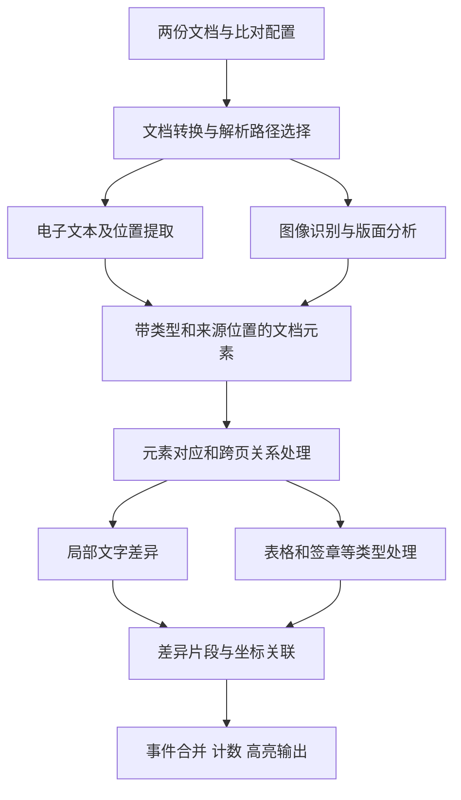

# TextIn 文档比对未公开实现的证据分析

## 一、核心判断

**最可信的解释是：TextIn 先把文档转换为带类型、阅读顺序和位置的元素，再完成元素对应、局部文字差异和展示聚合。它的速度优势很可能同时来自解析服务的工程优化与比对阶段的计算控制，现有证据不足以归结为某一种秘密算法。**

合同比对官方 FAQ 明确表示，私有化部署不需要大模型。这支持“基础比对无需依赖生成式大模型”的判断，但不能推出“不使用神经网络、向量模型或语义匹配”。合合信息同时公开了自研文本向量模型，因此“无需大模型”和“具备语义模型能力”并不矛盾。[^1][^6]

TextIn 另有官方文章披露，xParse 通过单页任务拆分、多机并行、模型蒸馏和减少重复预处理提升解析速度。这些设计已属于公开的厂商自述；**合同比对是否复用同一引擎、同一版本和同一集群，仍未证实**。不能把 xParse 的宣传速度直接移植为合同比对性能。[^2]

两份保存的真实比对响应支持更细的推断：输出按文本、表格和印章等元素组织；多数元素 ID 与页码、坐标直接对应；差异会经过分组与合并。它们同时暴露出跨页表格错配、签署主体混淆和重复事件。这说明比对速度不能代替业务正确性，也不能把外部返回的事件总数当作人工真值。[^12][^13]

### 判断等级

| 命题 | 判断 | 证据边界 |
|---|---|---|
| 基础合同比对可不部署大模型 | 官方明确说明 | 不代表公有云所有版本完全不使用大模型 |
| 文档解析与差异计算分别报告耗时 | API 与真实响应确认 | 两个计时器的起止边界未公开 |
| 输出具有元素类型和几何定位结构 | 真实响应确认 | 不能由输出反推出唯一内部数据结构 |
| 内部很可能使用元素对应与局部细比对 | 较强推断 | 也可能先全文比对，再投影回元素 |
| xParse 使用多机页面并行和轻量化模型 | 官方技术自述 | 未获得集群追踪或独立复现实验 |
| 合同比对使用同一页面并行设施 | 合理假设 | 缺少产品版本和服务调用关系证明 |
| 使用 Myers、LCS、稀疏动态规划或特定重排模型 | 未确定 | 现有输出可由多类算法产生 |
| 使用 C++、TensorRT、固定 GPU 型号或跨任务缓存 | 未确定 | 毫秒计时、PNG 页图和连续 ID 都不足以证明 |

## 二、产品范围与计时口径

### 2.1 三种能力不能混为一谈

本报告的直接研究对象是 `doc-compare.intsig.com/api/contracts/v3/comparison/external/` 下的合同比对接口。xParse 文档解析是相邻产品；合同风险审查、问答与信息抽取又是不同任务。某个合同审查演示使用大模型，不能证明基础文字比对也使用相同模型。

当前 xParse 文档区分电子解析、图像解析、轻量解析和视觉语言模型等模式。新版还可配置字符详情、表格结构与跨页合并方式，说明 TextIn 对外提供多种解析路径，而不是所有输入固定走一种能力组合。**这些配置不是合同比对接口的可直接替换参数。**[^4][^5]

### 2.2 可核验的两份实际结果

| 保存样本 | 两侧页数 | `parse_duration` | `compare_duration` | 两字段之和 | 解析占字段和 |
|---|---:|---:|---:|---:|---:|
| `8eb0a225` | 22 + 22 | 7.790 s | 0.960 s | 8.750 s | 89.0% |
| `437aa215` | 55 + 54 | 20.107 s | 1.384 s | 21.491 s | 93.6% |

两样本均设置 `use_pdf_parser="true"`、`remove_watermark="false"`、`merge_diff=1`，印章与标点均未配置为忽略。原始结果和请求元数据已经保存，结构统计可由本报告附带的只读脚本重新生成。表中的相加只是算术处理，不代表已证明服务内部严格串行。[^12]

API 把两个字段分别描述为解析耗时与比对耗时，单位毫秒，但没有说明排队、渲染、文档转换、结果持久化是否计入，也没有给出跨文档任务的累计或并行口径。客户端实际等待还可能包含上传、下载、创建任务、轮询间隔及响应传输。[^3]

因此，`1.384 s` 不能与本项目完整任务的 `171.78 s` 直接相比。即使拿 TextIn 两字段和比较，本项目的计时边界、硬件、缓存状态、质量输出和服务负载也尚未统一。当前能成立的是“两个样本返回的比对计时明显小于解析计时”，不是稳定倍数或服务承诺。

### 2.3 页数增长不能证明算法复杂度

两侧总页数从 44 增至 109，为 2.48 倍；解析时间为 2.58 倍，比对时间为 1.44 倍。这与“比对工作受变化区域或固定开销影响较大”相容，却不足以证明线性、次线性或增量算法。两个合同不是同一内容的等比例扩展，文字量、相似程度、图表和签名密度均不同。

另一处口径差异来自官方材料：2024 年合同比对介绍给出百页约两分钟，2025 年 xParse 文章讨论百页秒级解析。产品、时间、输入和统计方法都不同，不能解释成同一引擎完成了确定倍数的升级。[^2][^7]

## 三、真实响应透露出的结构

### 3.1 元素输出比纯字符串输出丰富

长样本的 106 个顶层对象包括：文本 79、图片 9、印章 6、表格 2、行 2、单元格 8。短样本包含文本 10、印章 6、表格 4、单元格 4。表格事件带有外层区域及内层文字差异，部分文本叶节点还带 `table_index`、`cell_position`、`structured_id`、`sub_type`。[^12]

这直接说明**输出阶段保留了元素归属与定位信息**。一种自然实现是先建立文档中间表示：页面包含文本块、表格、印章等对象，文本片段可回溯到页面坐标。相同结构也可能由后处理适配层生成，因此不能进一步宣布“所有模块共享同一个 IR”或“只做一次 OCR”。

对性能而言，中间表示的价值是减少重复工作：已识别的文本与位置可以供配对、局部差异和高亮复用。这是可独立实施的工程设计，无需知道 TextIn 内部的类名、序列化格式或语言。

### 3.2 元素 ID 具有明显几何特征

只读核对发现，短样本 20/24、长样本 98/106 个事件的 `element_id`，能够与事件内某个叶节点的以下组合完全对应：

```text
doc_index + "_" + page_index + "_" + first_polygon_y + "_" + first_polygon_x
```

例如长样本首项 `1_0_278_527`，与标准侧第 0 页、首个多边形起点 `(527, 278)` 相符。这个规律更像几何锚点标识，而不是合同条款的业务主键。剩余不匹配事件表明，该公式并不是可保证的接口规范。[^12]

两个样本均有 ID 重复。工程上应把外部事件顺序、类型、状态和证据共同保存，不能只用 `element_id` 去重或覆盖数据库记录。重复 ID 也不能证明服务缓存命中，更不能用于推算内部对象总量。

### 3.3 `char_polygons` 不能按名称理解为逐字符框

在递归统计包含 `text` 与 `doc_index` 的 JSON 对象时，短样本有 130 次叶节点出现，其中 110 次文本非空，108 次文本长度与框数量不相等；长样本有 296 次出现，其中 201 次文本非空，132 次不相等。这里统计包含 `area` 和 `diff` 中重复出现的证据，**不是独立 OCR 字符或文本行数量**。[^12]

常见表现是一段文字配一个四边形。还有零面积框，符合在另一侧不存在对应内容时保留插入或删除定位锚点的可能用途，但也可能包含坐标退化，必须逐项判断。不能据此认定所有坐标都来自字符检测器，更不能把所有零面积框删掉。

这个细节限制了逆向推断：输出可能经历行框合并、差异片段投影或位置插值。内部是否有更细字符框，接口没有完整暴露。准确重建高亮，需要同时理解文本偏移、证据区域和空侧锚点，而不是根据字段名假设一一对应。

### 3.4 统计层和差异计算层可能分离

短样本 `diff_info.total=24`，但新增 13、修改 7、删除 3，三者之和为 23；顶层数组另有一条 `MATCH`。长样本的 T91–T94 则在 `type`、`status`、整个 `diff` 载荷上相同，但关联元素不同。两者都说明顶层对象数不必等于独立业务变化数。[^12]

较合理的解释是：细粒度差异形成后，还有按照元素、表格或显示区域生成事件的阶段。另一种解释是不同类型的输出适配器采用不同计数规则。现有证据不足以定位到具体函数，但足以否定“一个顶层事件必然对应一个独立变化”的假设。

### 3.5 有手写类别，不代表有可靠主体理解

长样本中出现 `sub_type="handwriting"`；部分签名又作为普通文本或图片返回。两份响应的 `char_candidates` 均未出现非空候选列表。这只能说明当前返回内容，没有证明服务内部不存在候选字、置信度或纠错步骤。[^12]

已经核对的长样本存在买方与设计方字段配对错误。因而“能识别手写和印章”与“能正确理解谁签署了什么字段”是两层能力。角色与字段归属必须单独验收，不能用 OCR 的字面相似替代。[^13]

## 四、可能的内部流水线

以下是与证据相容的**候选架构**，不是 TextIn 内部系统图。实线仅表达候选数据流，不表达已确认的服务部署或实际先后顺序。



### 4.1 解析路径：有电子解析分支，扫描侧仍是关键

合同比对创建接口允许启用 PDF 解析，也允许强制 OCR；水印擦除属于可选处理。由此可确认输入处理存在可配置差异，但无法确认 PDF 与 OCR 的选择发生在文件、页面还是区域级。[^8]

本地探针显示，长样本原文 55 页中 52 页拥有至少 80 个原生字符，总计 35,980 字符；对比扫描件 54 页只有一页达到同一条件，总计 149 字符。两份 PDF 的简单文本抽取均约 0.05 秒，但这没有完成表格、手写、印章或可靠阅读顺序识别。[^14]

**推断：**电子侧存在显著节省识别工作的机会，但它无法独自解释扫描侧也快速完成。若两侧并行，总耗时由较慢扫描侧主导，那么电子侧再提速也未必缩短关键路径。TextIn 的扫描识别吞吐、结构模型和服务排队仍是需要解释的主要变量。

### 4.2 解析服务：页面并行比客户端多开请求更有解释力

针对 xParse，厂商披露了把单页任务分配到多台机器并行处理的方式。相邻官方技术文章还讨论了轻量模型及重复计算减少，但没有公布节点数、显存预算、批大小和完整测量条件。[^2][^9]

**推断：**如果合同比对复用这类设施，它就可能同时缩短多页等待和单页处理，而本项目仅增加外部 HTTP 并发未必产生同样效果。服务端可以在页面层安排任务，客户端的整份 PDF 请求却可能竞争同一推理队列。两种“并发”应分别测量。

下面的表达式可用于分析此类系统，不是对 TextIn 的参数估计：

```text
解析墙钟时间 ≈ 排队时间 + 拆分开销
             + max(各工作节点承担的页面处理时间)
             + 跨页整合与结果写入
```

这个模型解释了为什么任务数量、单页难度和负载均衡都可能影响延迟。它不证明推理采用动态批处理，也不证明一个任务一定占用几十个 GPU。异构 CPU/GPU 阶段、共享服务和原生文本分支均可产生相近外部表现。

### 4.3 对应关系：可能按块收缩问题，再做细差异

对于高度相似的合同，一种高效方法是先识别稳定的相同块，把不确定区域限制在相邻锚点之间，再对剩余块处理插入、删除、拆分、合并或移动。编号、文本指纹、表格结构和相邻关系都可作为锚点信号。这是本报告提出的候选解释，不是已确认的 TextIn 算法。

长样本比较耗时较短、输出存在局部错配且能够跨页显示，与上述方法相容。反过来，如果内部对所有条款进行密集语义重排，它也可以通过常驻模型、批量推理和更强硬件较快完成。**不能仅凭 1.384 秒排除全局匹配，更不能把局部错误当作“完全没有语义模型”的证据。**

### 4.4 字符差异：成熟算法可以很快，具体名称仍未知

Myers 的差异算法以序列总长度 N 和最短编辑脚本长度 D 为主要变量，其经典形式为 O(ND)，适合变化较少的序列。这提供了一种无需逐条大模型分析就能快速定位文字变化的公开技术解释。它并不是 TextIn 已采用 Myers 的证据。[^10]

其他相容方案包括最长公共子序列变体、分块哈希加局部编辑距离、启发式序列匹配，以及基于结构匹配结果进行字符投影。即使两个系统产生相同 diff，也不能证明算法相同：很多输入的最优编辑脚本本来就接近唯一，展示层还可能消除底层算法差异。

### 4.5 表格、印章和图片：类型独立不等于全量视觉比较

表格类型的嵌套响应支持“结构与内容分别处理”的推断。跨页续表出现整表新增与行删除，也可能来自解析结果不同、表格关联失败或差异展示拆分，不能锁定为某一层。定位根因需要保存两侧完整解析对象及其配对关系，当前响应只提供部分结果。[^12][^13]

官方 FAQ 表示纯图像默认忽略，而真实长样本返回了 9 条 `image`。这两个观察并不充分矛盾：图片新增或缺失与两幅图片内容的逐像素比较不同；也可能存在版本或配置差异。现阶段只能确认样本会输出图片类事件，不能声称支持任意图片细节比对。[^1][^12]

### 4.6 结果服务：异步接口不揭示后台队列实现

创建任务后再查询状态的接口说明客户侧采用异步工作流，但无法判断后端使用哪种消息队列、是否独立微服务或是否在同一进程执行。页面记录中的图片类型和尺寸也可能主要服务于预览，不能证明 OCR 输入采用同一分辨率。[^3][^8][^12]

较小的 `compare_duration` 还存在另一个解释：部分配对预处理、特征生成或模型计算可能计入解析阶段。没有官方计时边界之前，不应把所有“理解文档”的工作都假定包含在比对字段中。

## 五、替代解释与反证

### 5.1 三种仍然相容的架构

| 候选 | 如何产生现有结果 | 主要可区分现象 |
|---|---|---|
| A：先结构配对，再局部文本 diff | 表格、正文、印章先归类配对；变化区域细比对 | 相同文字换元素类型、跨页拆表时，配对和耗时发生明显变化 |
| B：全文序列 diff，再投影回元素 | 阅读顺序形成长序列；字符变化回填到几何元素 | 重复段落与顺序置换影响较大；显示层可能拆出重复事件 |
| C：语义或多模态块匹配，再局部 diff | 模型给块相似分，结构约束选择对应，随后字符比较 | 字面差异很大但语义一致时仍能稳定配对；不能只观察总相似度 |

真实实现也可能混合三者：正文用序列对齐、复杂表格用结构匹配、模糊段落再调用语义模型。当前最稳妥的结论是“元素与位置在结果形成过程中发挥作用”，而不是强行选出唯一架构。

### 5.2 错误分布能提供线索，但不是源代码证据

长样本有四类可复查行为。其一，续表两侧都存在，却拆成新增和删除；其二，删除附图附近的正文被配到签字页页眉；其三，不同签约主体的电话和其他字段被错误配对；其四，同一差异载荷因元素关联不同出现四次。[^13]

这些观察使“几何位置、顺序和元素分组影响较大”的解释更可信。同时，它们并不证明系统只看位置：一个语义模型在短文本、数字密集字段或错误 OCR 上也可能失败。更有区分力的实验是保持文字、位置、结构三者中的两项不变，仅改变第三项。

### 5.3 目前不能确认的性能来源

| 解释 | 当前缺口 | 可检验方式 |
|---|---|---|
| 相同文件跨任务缓存 | 没有冷暖对照，也没有缓存标识 | 原字节重放、仅改文件元数据、重新编码同视觉内容交错测试 |
| 标准文档一对多复用 | 接口支持一对多，不等于内部只解析一次 | 同一标准件分别创建任务与单次一对多比较，核对计时口径 |
| 区域级二次 OCR | 返回未暴露每个区域的引擎选择 | 仅增加局部手写/模糊，观察耗时和局部输出；仍需服务追踪确认 |
| 神经网络量化或特定推理框架 | 没有部署清单和性能追踪 | 厂商提供模型及推理配置，或在可控私有化实例中测量 |
| 全流程只用一种 OCR | 输出模式无法表明模型调用数量 | 获取解析阶段追踪或接口诊断，单靠结果难以区分 |
| 严格业务语义配对 | 样本存在主体错配 | 主体、字段、数值交换的受控样本，人工真值验收 |

## 六、开源、专利与技术资料的适用范围

TextIn 官网链接到 `intsig-textin` GitHub 账号。公开入口包含解析 SDK、前端组件、集成示例和文本向量模型；已核查的这些入口没有提供足以确认合同比对私有核心实现的源码。前端高亮或 JSON 适配代码可以解释展示契约，不能当作后端对齐算法。[^6][^11]

专利需要先核对申请主体。检索容易命中的 CN120126161A 属于金蝶，CN115376153B 属于南京擎盾；两者不能作为 TextIn 内部实现的证据。它们最多是独立技术路线参考，本报告不据此推断 TextIn 采用其方法。[^15][^16]

CN111353492B 列有上海合合信息科技发展有限公司等共同主体，内容涉及固定版式文档的模板匹配、文字与图像关联以及几何矫正。它可以证明相关技术有公开披露，但对象是标准化文档的信息提取，不是当前合同版本比较引擎的部署说明。[^17]

公开能力、研究方法、专利方案和生产版本之间，应保留明确的证据边界。公司具备某项能力，不能推出目标产品必然启用；某个方案能够解释输出，也不能推出其他方案不可能。无需补齐一个听起来完整但无法验证的“秘密技术栈”。

## 七、验证假设的黑盒实验

### 7.1 最小可解释输入

实验应使用可公开的合成合同，并同步保存真实的编辑操作。例如只修改一个数字、交换两条段落或移动一个表格，明确记录预期变化及页内位置。原生 PDF 与扫描 PDF 必须来自同一版面，扫描分辨率、压缩、旋转等变量固定；不能拿两份不同合同分别代表两种模式。

首次筛查可限定为 12 个条件、每条件 3 次，共 36 个任务。重复顺序应交错随机化，并保留唯一输入哈希、完整配置、发送时间、成功状态和客户端等待。三次重复只适合发现明显差异，不适合宣布 P95、稳定吞吐或算法复杂度。

### 7.2 首轮条件

以下均以同一份 10 页合成合同为基底，只在一侧引入明确操作；表中各行是一个条件，合计 12 个。电子件不带隐藏 OCR 文字，扫描件由同版面生成。初始轮禁用水印擦除、保持标点，统一差异合并配置。

| 条件 | 输入或操作 | 核心观察 |
|---|---|---|
| 1 | 原生对原生，仅改一个数字，PDF 解析开 | 电子解析基线、关键数值召回 |
| 2 | 条件 1 强制 OCR | PDF 解析分支的时间与误识别差异 |
| 3 | 原生对扫描，同一数字变化，PDF 解析开 | 扫描侧是否成为关键路径 |
| 4 | 扫描对扫描，同一数字变化 | 两侧解析是明显叠加还是近似重叠 |
| 5 | 原生对原生，内容完全一致 | 固定开销、是否仍产生非变化对象 |
| 6 | 同内容重新分页，文字顺序不变 | 对跨页重排的稳定性 |
| 7 | 将一段从第 2 页移动到第 8 页 | 移动恢复还是新增/删除，不能要求接口必有 MOVE |
| 8 | 重复三段相同模板文字，仅改中间一段数字 | 重复锚点歧义和错误对应 |
| 9 | 同一表格跨页拆分，所有值不变 | 结构对应与内容一致性的分离 |
| 10 | 同样文字从正文改为表格单元格 | 类型是否显著影响匹配 |
| 11 | 两主体的电话互换，姓名标签和位置不变 | 字段是否跟随角色，或仅跟随局部文本 |
| 12 | 条款作明显同义改写，关键数值保持 | 配对位置是否保持；相似度不是唯一指标 |

表中条件 4 只有在硬件负载相近且解析计时语义清楚时，才能用于支持并行假设；其他条件也可能触发不同预处理。首轮作用是选择值得进一步隔离的变量，而不是一次确定整套内部实现。

### 7.3 后续有针对性的实验

**规模与变化密度。** 固定每页字符密度和元素构成，使用 5、10、20、40、80 页；分别保持固定变化数与固定变化比例。拟合固定开销加工作量的候选曲线，而不是直接对两点取对数推断复杂度。重复内容构造会触发不同捷径，应另建非重复页面组。

**缓存。** 对同一输入原字节重放、仅更换文件名、仅更改 PDF 元数据、重新编码同视觉内容，并插入新合同作对照。第二次更快还可能来自连接复用、模型预热或负载波动；只有匹配文件身份的系统性差异，才支持缓存假设。更改文件元数据不能排除基于视觉或文本指纹的缓存。

**识别与展示。** 单独切换 `merge_diff`，比较变化片段的覆盖集合与事件数量；使用已存在于两侧的图片，仅改变内部一个小区域，区分图片内容比较与图片存在性检测。为判断 OCR 纠错，应把 `0/O`、`1/l/I` 放入文字、型号和金额三种上下文，避免“容错”吞掉真实数值变化。

**并发。** 在服务允许范围内，由低并发逐步增加，分别记录成功吞吐、任务延迟和失败率。提交 QPS、执行并发与 GPU 占用不是同一指标。缺少服务端追踪时只能描述外部行为，不能反推真实机器数量。

### 7.4 计时与质量记录

建议保留四个单调时钟时间点：开始创建请求、创建响应返回、最后一次确认未完成、首次确认完成。任务完成时刻位于最后两次有效状态观察之间；轮询间隔造成可量化的检测延迟。服务返回的解析与比较计时应原样单列，禁止偷偷补入或扣除。

质量至少核对：预设变化是否全部找到、未改区域是否误报、元素与主体是否对应正确、证据框是否落在正确位置。输入为空、服务报错、响应缺页和模型降级不能作为快速成功。每个成功结果应保存原始 JSON，再单独生成适合比较的规范化视图。

仅为比较业务内容，可从规范化视图排除任务 ID 和生成时间；原始结果仍完整保留。几何 ID 变化、事件顺序、合并数量和相似度另作观测量，避免一开始就删掉对推断有价值的信号。本报告没有新增 TextIn 文件提交；上述在线实验均为待执行设计。

## 八、对当前项目的具体影响

### 8.1 后续优化应覆盖扫描识别和解析后的工作

当前默认配置的长样本单次成功执行约 171.78 秒，其中 OCR/解析约 97.42 秒、页面对齐 14.08 秒、条款匹配 23.00 秒、文档准备 11.41 秒、汇总 10.66 秒。此前缓存已把页面对齐组件三轮中位数从 45.824 秒降至 13.989 秒，继续只做同类缓存很难解释或消除剩余差距。[^18]

以下是基于这次观测的预算计算，**不是新测速或可保证收益**：

| 假设其他阶段耗时不变 | 推算完整时间 | 含义 |
|---|---:|---|
| 仅把 OCR/解析降到 20.107 s | 约 94.47 s | 即使达到 TextIn 样本所报解析时间，仍略高于 90 s |
| 仅把页面对齐和条款匹配全部降到零 | 约 134.70 s | 仅重写匹配仍不足以达到 90 s |
| OCR/解析完全降到零 | 约 74.36 s | 是固定其他阶段下的理想下界，不是可实现方案 |

这说明扫描服务和解析后的计算都要改进。TextIn 的数字只作为假设预算输入，不代表两系统执行的解析工作相同，也不代表替换一个接口就能实现该预算。

### 8.2 先补观测，再改变工作量

当前项目的 OCR 请求以整份 PDF 为单位。建议让识别服务暴露排队、栅格化、版面检测、文字识别、表格恢复和序列化时间，同时记录每页工作量及失败原因。只有知道 97 秒主要花在哪里，才能选择页面调度、模型优化或减少重复处理。

此前两个任务并发虽然提高整体吞吐，却使单独约 50 秒的短任务延长至约 156 秒，并出现解析槽位等待。因此页面调度应包含公平性与小任务等待预算，不能简单提高客户端线程数。现有 PP-Structure 502 与重排输入超长也必须计入失败率。[^18]

### 8.3 可以借鉴的三项架构方向

**第一，复用解析产物。** 为文本、表格、签章建立统一的来源引用，保存原生提取与 OCR 观察的关联关系。一次页面栅格化、一次基础识别的结果尽量供多个模块使用；低置信区域再补充识别。这是目标设计，不能直接删除现有第二路 OCR，因为它可能承担召回与纠错作用。

**第二，限制昂贵匹配的范围。** 正文完全一致、双侧唯一且结构相容的块可形成锚点；锚点间区域做局部对齐，只有含糊区域进入语义召回和重排。编号、重复页眉、跨页段落和移动条款必须有冲突回退路径；模型调用减少必须与候选覆盖和最终正确性一同验收。

**第三，将观察不确定与真实变化分开。** 一侧没识别到字段，并不自动等于删除；相同电话文本也不自动代表同一主体。可以保留快速常规路径，并把表格对应失败、角色冲突和低置信文字送入局部复核，减少全文件反复补救。

上述方向分别对应现有混合提取器、页面对齐器与匹配器，具体文件见文末。此处没有新增业务代码或改变现有开关。

### 8.4 已有质量结果约束实施顺序

已有页面原生路由试验新增页眉与 `ISO/IS0` 差异，尚未通过质量验收；候选裁剪、模型输入去重与页面原生路由仍为关闭状态。固定 OCR 的 17 组结果虽保持完整差异对象一致，既有 Golden 仍有 55 条失败，不能宣布整体业务正确性通过。[^18]

建议按“服务计时与错误稳定性 → 固定解析结果下的匹配优化 → 原生/扫描来源融合 → 有界页面调度 → 局部补充识别”推进。每一步分别衡量成功率、时间和人工真值，避免把模型失败、少识别或少返回当作性能提升。TextIn 的错误案例应加入反例集合，而不是作为期望输出复制。

## 九、最终结论

对 TextIn 未公开实现，当前可以较深入地还原**问题分解方式与输出机制**，但还不能确认模型名称、实际匹配算法、部署语言、机器数量或缓存设计。最有价值的新证据是几何型元素 ID、非逐字符框、嵌套类型差异和独立展示计数，它们共同支持以文档元素及位置为基础的解释。

速度方面，公开资料已经提供了页面并行、模型轻量化和重复处理减少的工程路径；真实样本表明解析仍占其报告时间的大部分。对当前项目，研究价值在于重新分配识别与匹配的工作量，同时保持证据和业务质量，而不是追求与外部某个计时字段相同的数字。

## 来源与复核入口

公开来源核验截至 2026-09-15。无明确发布日期的动态 API 文档与仓库，不把检索引擎抓取时间当作发布日期。厂商文章中的性能描述属于厂商自述，不等于独立基准。

[^1]: 合合信息，《[FAQ｜合合信息合同比对产品常见问答](https://b.intsig.com/news/20251017174841309)》，2025-10-17。用于部署无需大模型、纯图像默认行为及产品边界。
[^2]: TextIn，《[文档解析｜揭秘 TextIn xParse 如何实现 2 秒百页 PDF 文档解析](https://www.textin.com/news/20251106195842085)》，2025-11-06。用于页面集群并行、模型蒸馏与重复预处理减少；不作为合同比对部署证明。
[^3]: TextIn，《[合同比对：获取差异信息](https://www.textin.com/document/doc-compare-diff-info)》，动态 API 文档，未标发布日期。用于异步状态、计时字段与返回契约。
[^4]: TextIn，《[文档解析 API](https://docs.textin.com/api-reference/endpoint/parse)》，动态文档，未标发布日期。用于 `auto/scan/lite/parse/vlm` 模式区分。
[^5]: TextIn，《[解析配置详解](https://docs.textin.com/xparse/v1/parse-config)》，动态文档，未标发布日期。用于字符详情、表格结构、跨页合并和多路径配置；不作为合同比对参数表。
[^6]: 合合信息技术团队，[acge_text_embedding](https://github.com/intsig-textin/acge_text_embedding)，公开代码仓库，页面未标统一发布日期。用于证明公司公开提供文本编码模型，不证明合同比对使用该模型。
[^7]: 合合信息，《[担心用印合同与电子版对不上？TextIn 合同比对来啦](https://b.intsig.com/news/221)》，2024-11-07。用于早期合同比对百页耗时的厂商口径。
[^8]: TextIn，《[合同比对：创建比对任务](https://www.textin.com/document/doc-compare-create)》，动态 API 文档，未标发布日期。用于 PDF/OCR 配置、差异合并及任务创建流程。
[^9]: TextIn，《[大文件 PDF 解析：500 万页文档离线批量处理 3 天搞定](https://www.textin.com/news/20260402152537516)》，2026-04-02。用于相邻解析产品的工程说明；宣传数据未用于计算项目收益。
[^10]: Eugene W. Myers，《[An O(ND) Difference Algorithm and Its Variations](https://www.janelia.org/publication/ond-difference-algorithm-and-its-variations)》，Algorithmica，1986，1:251–266，DOI: 10.1007/BF01840446。仅作独立算法候选原理。
[^11]: IntSig，[官方 GitHub 账号](https://github.com/intsig-textin)及 [xparse-frontend](https://github.com/intsig-textin/xparse-frontend)，动态公开仓库。官网导航直接链接该账号；前端项目描述的是解析结果展示。
[^12]: 项目保存的真实 TextIn 响应及本次结构核对：[短样本](/Users/liyuanxin/PyCharmMiscProject/rixin-contract-comparison/output/analysis/textin-8eb0a225/textin-result.json)、[长样本](/Users/liyuanxin/PyCharmMiscProject/rixin-contract-comparison/output/analysis/textin-437aa215/textin-result.json)、[结构统计](/Users/liyuanxin/PyCharmMiscProject/rixin-contract-comparison/output/analysis/textin-internals-20260915/response-audit.json)、[只读复核脚本](/Users/liyuanxin/PyCharmMiscProject/rixin-contract-comparison/output/analysis/textin-internals-20260915/audit_responses.py)。各样本目录另存 `request-metadata.json`；统计记录输入响应 SHA256。页数、类型、ID、框和重复事件均来自原始响应。
[^13]: 项目报告《[437aa215：TextIn 实测后的误报分析](/Users/liyuanxin/PyCharmMiscProject/rixin-contract-comparison/docs/reports/437aa215-textin-verified-analysis.md)》，2026-09-14，尤其第 2、5 节。人工图像核对范围以该报告为准，未扩展为完整误报率。
[^14]: 项目《[TextIn 速度分析](/Users/liyuanxin/PyCharmMiscProject/rixin-contract-comparison/docs/reports/textin-speed-analysis-20260915.md)》与[原生文本探针及计时证据](/Users/liyuanxin/PyCharmMiscProject/rixin-contract-comparison/output/analysis/textin-speed-20260915/timing-evidence.json)，2026-09-15。
[^15]: 金蝶软件（中国）有限公司，[CN120126161A：文档比对方法、装置、计算机设备和可读存储介质](https://patents.google.com/patent/CN120126161A/zh)，2025-06-10 公开。只用于申请主体核对。
[^16]: 南京擎盾信息科技有限公司，[CN115376153B：一种合同比对方法、装置及存储介质](https://patents.google.com/patent/CN115376153B/zh)。2024-05-17 公告。只用于申请主体核对，不作 TextIn 技术证据。
[^17]: 上海合合信息科技发展有限公司等共同申请主体，[CN111353492B：一种标准化文档的图像识别和信息提取方法及装置](https://patents.google.com/patent/CN111353492B/zh)，A 文本 2020-06-30 公开，B 文本 2023-10-13 公告。用于固定版式模板与几何矫正的已披露技术范围。
[^18]: 项目《[合同比对性能优化实施与验证](/Users/liyuanxin/PyCharmMiscProject/rixin-contract-comparison/docs/reports/comparison-performance-optimization-verification-20260915.md)》，2026-09-15。用于当前默认计时、组件基准、并发结果、质量门禁和未启用试验状态。

相关代码：[混合提取器](/Users/liyuanxin/PyCharmMiscProject/rixin-contract-comparison/backend/app/services/extractors/ppstructure_ocr_hybrid.py)、[页面对齐](/Users/liyuanxin/PyCharmMiscProject/rixin-contract-comparison/backend/app/services/page_alignment.py)、[条款匹配](/Users/liyuanxin/PyCharmMiscProject/rixin-contract-comparison/backend/app/services/matcher.py)、[匹配模型调用](/Users/liyuanxin/PyCharmMiscProject/rixin-contract-comparison/backend/app/services/matching/providers.py)。
